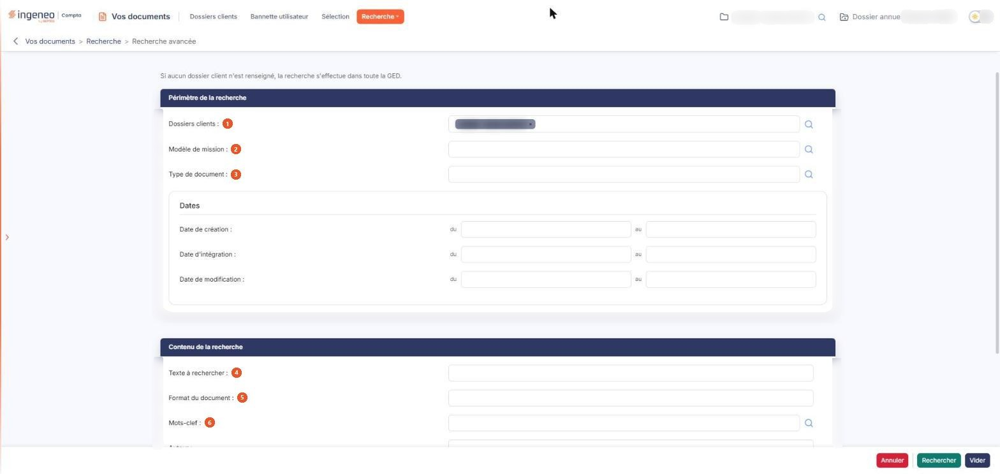
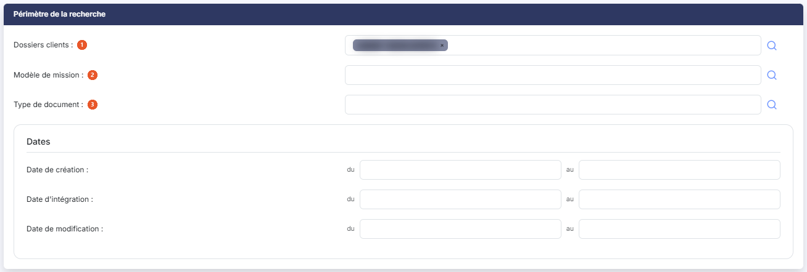
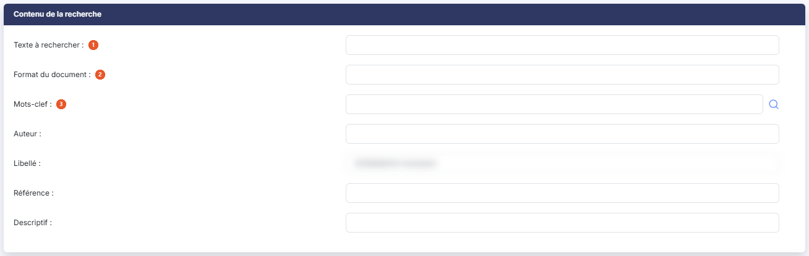
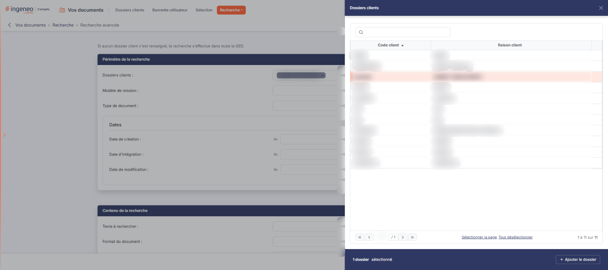

# Recherche avancée


**Où le trouver :** Menu **Recherche › Recherche avancée**



**En bref** — Cet écran vous permet de retrouver un document de la GED à partir de plusieurs critères combinés : périmètre, type, dates, texte, format, mots-clefs, auteur, libellé, référence.

* Pour lancer une recherche : renseignez un ou plusieurs critères, puis bouton \[Rechercher] ; les documents trouvés s'affichent dans « Résultat de recherche ».
* Pour choisir un type de document ou des mots-clefs : pictogramme « Loupe » à droite du critère, cliquez sur les lignes voulues (une ligne retenue est surlignée), puis refermez le panneau par la croix de son bandeau de titre.
* Pour chercher dans plusieurs dossiers (abonnés experts-comptables) : pictogramme « Loupe » du critère « Dossiers clients », cliquez sur les lignes voulues, puis bouton \[+ Ajouter le dossier].


Cet écran vous permet de retrouver un document de la GED à partir de plusieurs critères. Il ne présente aucune liste : vous y saisissez vos critères, puis vous cliquez sur bouton **\[Rechercher]** ; le logiciel affiche alors les documents trouvés dans l'écran « Résultat de recherche ».

<figure><figcaption>
Écran « Recherche avancée » de la nouvelle interface
</figcaption></figure>

Aucun critère n'est obligatoire. Lorsque vous en renseignez plusieurs, le logiciel ne retient que les documents qui répondent à tous. La recherche ne porte que sur les répertoires auxquels vous avez accès.

L'écran présente deux rubriques, dans cet ordre : « Périmètre de la recherche », qui délimite l'endroit où chercher, et « Contenu de la recherche », qui décrit ce que l'on cherche.

## Rubrique « Périmètre de la recherche »

<figure><figcaption>
Rubrique « Périmètre de la recherche »
</figcaption></figure>

| Champ                    | Ce qu'il faut savoir                                                                                                                                                                                                                                                                                                                                                                                                                                          |
| ------------------------ | ------------------------------------------------------------------------------------------------------------------------------------------------------------------------------------------------------------------------------------------------------------------------------------------------------------------------------------------------------------------------------------------------------------------------------------------------------------- |
| 1. **Dossiers clients**  | Les dossiers dans lesquels chercher. À l'ouverture de l'écran, le logiciel y place le dossier en cours ; la recherche ne porte donc pas d'emblée sur tous vos dossiers. L'écran le rappelle en tête, au-dessus des rubriques : « Si aucun dossier client n'est renseigné, la recherche s'effectue dans toute la GED. » Vous pouvez en retenir plusieurs : chaque dossier retenu s'affiche sous forme d'étiquette portant une croix, qui le retire du critère. |
| 2. **Modèle de mission** | Restreint la recherche aux répertoires rattachés au modèle de mission retenu.                                                                                                                                                                                                                                                                                                                                                                                 |
| 3. **Type de document**  | Restreint la recherche aux documents portant le type retenu. Les types de document se déclarent dans le panneau Paramètres, rubrique « Vos documents », onglet « Types de document ».                                                                                                                                                                                                                                                                         |

Viennent ensuite, dans un bloc « Dates », trois intervalles de dates : la date de création, la date d'intégration et la date de modification du document. Chacun porte son libellé — **Date de création :**, **Date d'intégration :** ou **Date de modification :** — puis se compose de deux zones : la borne basse, précédée de « du », et la borne haute, précédée de « au ». Le calendrier qui vous aide à saisir une date s'ouvre au clic dans la zone. Vous pouvez ne renseigner qu'une borne : la recherche s'effectue alors depuis cette date, ou jusqu'à cette date. Les deux bornes sont incluses dans la recherche.

## Rubrique « Contenu de la recherche »

<figure><figcaption>
Rubrique « Contenu de la recherche »
</figcaption></figure>

| Champ                     | Ce qu'il faut savoir                                                                                                                                                                                 |
| ------------------------- | ---------------------------------------------------------------------------------------------------------------------------------------------------------------------------------------------------- |
| 1. **Texte à rechercher** | Le logiciel recherche ce texte dans le **nom** du document.                                                                                                                                          |
| 2. **Format du document** | La zone est volontairement courte : elle attend l'extension du fichier, de trois ou quatre caractères.                                                                                               |
| 3. **Mots-clef**          | Restreint la recherche aux documents auxquels le ou les mots-clefs retenus sont affectés. Les mots-clefs se déclarent dans le panneau Paramètres, rubrique « Vos documents », onglet « Mots-clefs ». |

Les quatre derniers critères portent sur les informations saisies sur le document lui-même : son **Auteur :**, son **Libellé :**, sa **Référence :** et son **Descriptif :**.

## Le choix des valeurs d'un critère

<figure><figcaption>
Rubrique « Le choix des valeurs d'un critère »
</figcaption></figure>

Les critères de dossier, de modèle de mission, de type de document et de mots-clefs se renseignent par un panneau de choix, que vous ouvrez par le pictogramme « Loupe » placé à leur droite. Les quatre panneaux s'ouvrent à droite de l'écran et sont bâtis de la même façon : un titre (« Dossiers clients », « Modèle de mission », « Type de document » ou « Mots-clef »), un champ « Rechercher… », sans bouton \[Afficher], qui restreint la liste, la liste elle-même et son compteur de pages. Il n'y a ni bouton **\[Annuler]** ni bouton **\[Valider]** : une croix, dans le bandeau de titre, referme le panneau. Dans le panneau des dossiers, le pied indique le nombre de dossiers retenus (« 1 dossier sélectionné ») et porte le bouton **\[+ Ajouter le dossier]**, qui ajoute à votre recherche les dossiers retenus.

La liste n'a pas de cases à cocher : une ligne retenue est surlignée, et les liens « Sélectionner la page » et « Tout désélectionner », sous la liste, permettent de retenir toute la page ou de tout écarter. Les quatre critères acceptent donc plusieurs valeurs. Le dossier en cours y apparaît déjà sélectionné (ligne surlignée) à l'ouverture de l'écran.

Tant qu'aucun modèle de mission, aucun type de document ou aucun mot-clef n'est enregistré, le panneau correspondant affiche « Aucun élément à afficher. ». La liste des dossiers présente son code client et sa raison sociale, sous les intitulés de colonnes « Code client » et « Raison client » ; la fenêtre de choix du dossier de l'écran « Bannette utilisateur » nomme les mêmes colonnes « Code Client » et « Raison Sociale ». Il s'agit bien des mêmes informations.

## Les boutons de bas de page

Les trois boutons se placent en bas à droite de l'écran, dans cet ordre : \[Annuler], \[Rechercher] et \[Vider].

bouton **\[Rechercher]** — enregistre vos critères et ouvre l'écran « Résultat de recherche », qui présente les documents trouvés.
