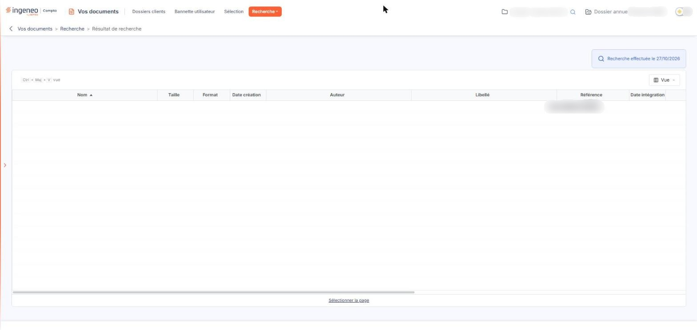

# Résultat de recherche


**Où le trouver :** Menu **Recherche › Résultat de recherche**



**En bref** — Cet écran présente les documents trouvés par votre dernière recherche avancée et les conserve jusqu'à la recherche suivante.

* Pour modifier votre recherche : revenez sur la sous-option « Recherche avancée », qui retrouve vos critères tels que vous les avez laissés.
* Pour choisir les colonnes affichées : bouton \[Vue].


Cet écran présente les documents trouvés par votre dernière recherche. Il n'a pas de contenu propre : il est le prolongement de la sous-option « Recherche avancée », où vous saisissez vos critères.

<figure><figcaption>
Écran « Résultat de recherche » de la nouvelle interface
</figcaption></figure>

Tant que vous n'avez lancé aucune recherche, le logiciel ne peut donc rien vous présenter : il vous conduit à l'écran des critères.

En haut à droite, au-dessus de la liste, une pastille rappelle la date à laquelle la recherche a été effectuée (« Recherche effectuée le … »).

Cet écran ne comporte ni bouton de bas de page, ni lien de retour aux critères : pour modifier votre recherche, revenez sur la sous-option « Recherche avancée ».

## La liste des documents trouvés

La liste présente, pour chaque document, son nom, sa taille, son format, sa date de création et son auteur, puis les informations de classement et de suivi : libellé, référence, date d'intégration et utilisateur qui l'a intégré, date de la dernière modification et utilisateur qui l'a modifiée, descriptif. Ce sont les mêmes colonnes que dans les autres listes de documents de la GED ; selon la résolution de votre écran, vous atteignez les dernières en faisant défiler la liste horizontalement, et chacune peut servir de critère de tri.

Aucune colonne n'indique le dossier dont provient un document, alors que la recherche peut porter sur plusieurs dossiers à la fois. Si vous devez distinguer l'origine des documents, relancez la recherche dossier par dossier.

Le nombre de lignes par page dépend de la résolution de votre écran.

Lorsqu'aucun document ne correspond à vos critères, la liste affiche « Aucun élément à afficher. ». Le logiciel ne rappelle pas vos critères à cet endroit : retournez sur « Recherche avancée » pour les élargir.

La barre de la liste ne porte que le bouton \[Vue], qui vous permet de choisir les colonnes affichées. Elle ne comporte ni champ de recherche, ni bouton \[Filtres], ni bouton \[Exporter], contrairement aux listes des sous-options « Bannette utilisateur » et « Sélection ». Sous la liste, le lien « Sélectionner la page » sélectionne les lignes de la page affichée.
