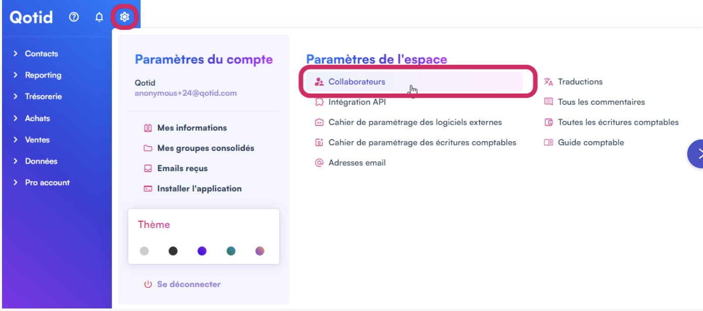
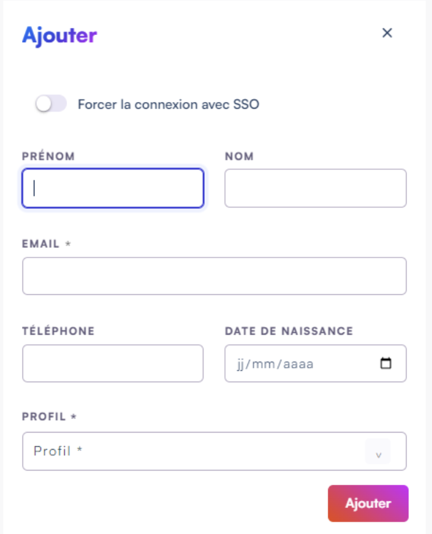

# Comment ajouter / modifier un collaborateur

## Ajouter un collaborateur

Vous souhaitez élargir votre équipe et ajouter un collaborateur sur Qotid ? Rien de compliqué.

* Pour cela, cliquez sur "**Paramètrage espace**" en bas à gauche. Puis sur "**Collaborateurs**"
* Ici, vous voyez la liste de tous les collaborateurs. Pour en ajouter un nouveau, cliquez sur "**Ajouter un collaborateur**".
* Maintenant, remplissez toutes les informations demandées, nom, prénom, email et ajouter un profil/rôle à votre nouveau collaborateur. (Sélectionnez lien vers guide lors de la prochaine étape pour comprendre les droits qui lui seront affectés). Vous devez également cocher les groupes / établissements auxquels l'utilisateur aura accès. Si vous cochez un groupe qui comprend trois établissements, ceux-ci sont automatiquement cochés. Ensuite, cliquez sur "**Valider**".

Enfin, votre collaborateur reçoit instantanément un email comprenant un login ainsi qu'un mot de passe afin qu'il puisse accéder à son espace. Attention, il est possible que cet email arrive dans ses spams, il faut donc autoriser l'email.

## Modifier un collaborateur

Votre nouveau collaborateur apparaît dorénavant dans la liste, vous pouvez à tout instant modifier ses informations ou les établissements auxquels il a accès en cliquant sur le crayon "**Editer**".
