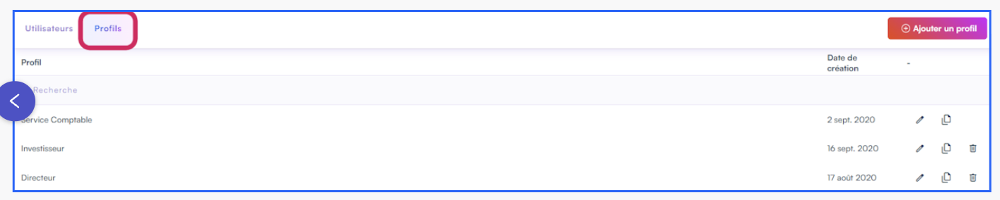
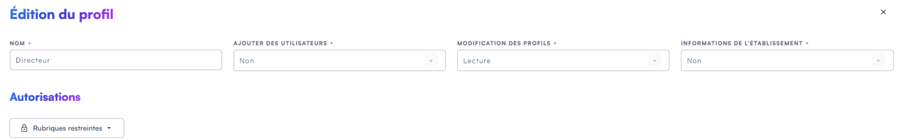

# Comment créer ou modifier un profil / rôle pour mes collaborateurs ?

## Créer un profil utilisateur

Pour créer un profil il faut en avoir l'autorisation. Par défaut, les administrateurs ont cet accès.

* Cliquez sur "**Paramètrage espace**" puis sur "**Collaborateurs**".
* Cliquez sur "**profils**".

Appuyez sur "**Ajouter un profil**".

## Configurer un profil utilisateur

Vous êtes dorénavant sur la page de création. Insérez en premier le nom que vous souhaitez donner au profil. Ensuite plusieurs options s'offrent à vous en fonction des droits que vous souhaitez donner à vos collaborateurs :

* **Ajout d'utilisateur** : vous donnez la possibilité ou non aux collaborateurs d'ajouter à leur tour des collaborateurs, vous pouvez également choisir de leur laisser cette possibilité mais en ayant la validation des administrateurs.
* **Modification des profils** : si vous souhaitez laisser la possibilité à vos collaborateurs de lire ou éditer les profils.
* **Information de l'établissement :** si vous souhaitez laisser la possibilité à vos collaborateurs de lire ou éditer les informations de l'établissement (adresse, nom, etc.).
* **Comptes restreints :** si vous souhaitez restreindre des comptes. Les comptes cochés ne seront jamais visibles pour ces utilisateurs.

Vous pouvez désormais déterminer les différents accès aux modules.


Les différents blocs qui s'affichent dépendent des modules auxquels vous avez accès sur votre espace et de l'abonnement en cours (Module Reporting/BI, module Achat, module Trésorerie, module Note de frais, Module paiement)


* **Rapport et comptes de résultat** : Vous pouvez autoriser ou non l'accès au module, la création et la modification de rapports, la possibilité de lire les commentaires, d'éditer des commentaires (dans ce cas, la lecture de commentaire est automatiquement autorisée), puis la modification des associations comptables.
* **Données ventes** : Vous pouvez autoriser ou non l'accès au module, l'import de données ventes et/ou l'édition des données.
* **Données comptables** : Vous pouvez autoriser ou non l'accès au module, l'import de données comptables et/ou l'édition des données.
* **Module workflow** (module complémentaire selon souscription) : Vous pouvez autoriser ou non la visualisation des validations. En l'autorisant, vous pouvez choisir le niveau de validation attaché au profil.
* **Module budget** (module complémentaire selon souscription) : Vous pouvez autoriser ou non la création et l'édition de budgets ainsi que l'édition de budgets par défaut.
* **Module des écritures comptables** (module complémentaire selon souscription) : Vous pouvez autoriser ou non l'exportation des écritures comptables.
* Pour terminer, vous pouvez choisir les vues par défaut que vous souhaitez ou non partager avec ce profil entre les vues comptes de résultat, les vues rapports et les vues budgets. C'est également ici que vous décidez si vous souhaitez partager vos données d'un budget par défaut avec vos collaborateurs. _NB : si vous partagez une vue budget (modèle de template) qui contient un budget par défaut (soit la donnée) et que vous n'avez pas partagé le budget par défaut, l'utilisateur ne pourra pas consulter les données)._

Enfin, pour sauvegarder ce profil, cliquez sur "**Validé**" en bas à droite.
