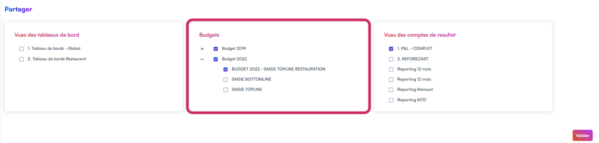

# Comment donner accès à un budget déjà défini par défaut à mes collaborateurs ?

## Donner accès à une vue par défaut

Si vous souhaitez partager une vue par défaut d'un budget par défaut avec d'autres collaborateurs attachés à un nouveau profil il faut mettre à jour les autorisations du profil concerné.

Pour commencer, cliquez sur "**Paramètrage**" représenté par un engrenage à gauche de votre écran puis sur "**Collaborateurs**" dans "Paramètrage Espace"

* Cliquez sur "**Profils**".
* Vous verrez la liste des profils créés. Pour mettre à jour un profil, cliquez sur le pinceau au niveau du profil correspondant.
* Ensuite il faut se rendre en bas de la page de paramétrage du profil. Vos budgets par défaut apparaîtront ici et vous pourrez cocher le budget à partager et la ou les vues associées permettant la saisie si nécessaire. Si votre budget n'apparaît pas, c'est qu'il n'a pas été paramétré par défaut.

