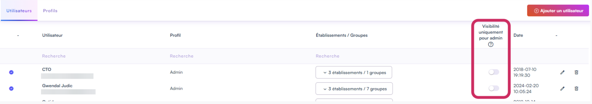

# Comment masquer un utilisateur à mes collaborateurs ?

## Masquer les collaborateurs

Les collaborateurs ayant accès à un établissement peuvent voir tous les autres collaborateurs ayant accès à ce même établissement lorsqu'ils souhaiteront envoyer des rapports par PDF. L'administrateur peut, s'il le souhaite, masquer certains collaborateurs pour ne pas que les autres puissent les voir et avoir accès à leur email par exemple. Pour cela, aller dans "**Mon espace**" en bas à gauche. Puis sur "**Collaborateurs**"

Ici, vous voyez la liste de vos collaborateurs. Pour les masquer, vous n'avez qu'à cocher les cases dans la colonne "**Visibilité uniquement pour admin**".

Maintenant, les collaborateurs cochés sont visibles uniquement pour les administrateurs.

