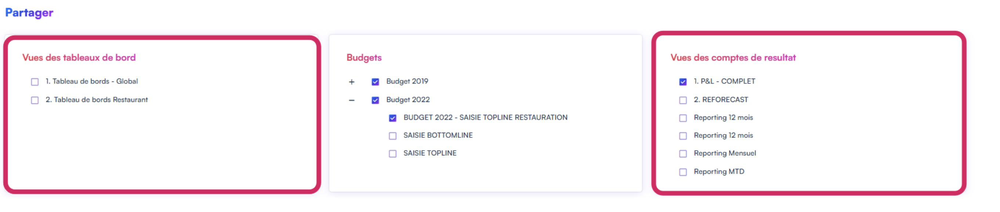

# Comment partager vos tableaux de bords ou compte de résultat déjà défini par défaut à mes collaborat

## Partager vos vues par défaut aux profils

Si une vue de votre compte de résultat ou dashboard est déjà définie par défaut (Lien vers guide sur comment définir une vue par défaut lors de la prochaine étape) et que vous souhaitez la partager avec d'autres collaborateurs attachés à un nouveau profil, il faut mettre à jour les autorisations du profil concerné.

Pour commencer, cliquez sur "**Paramètrage espace**" en bas à droite de Qotid puis sur "**Collaborateurs**"

* Cliquez sur "**Profils**".
* Vous verrez la liste des profils créés. Pour mettre à jour un profil, cliquez sur le pinceau au niveau du profil correspondant.
* Ensuite il faut se rendre en bas de la page de paramétrage du profil. Votre vue par défaut apparaîtra ici et vous pourrez cocher la vue que vous souhaitez partager. Si votre vue n'apparaît pas, c'est qu'elle n'a pas été paramétrée par défaut.

