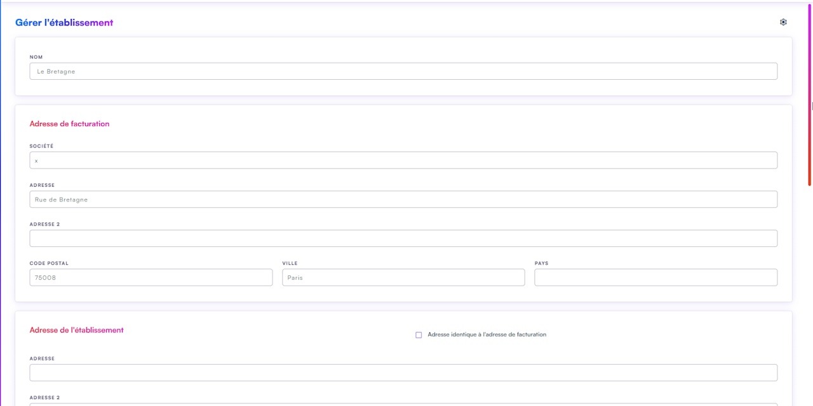

# Comment renommer et modifier les informations d'un établissement ?

## Gérer un établissement

Cliquez sur **le nom d'établissement** à droite afin de choisir l'établissement en question, puis cliquez sur **Gérer l'établissement**.

## Enregistrer les modifications

Une nouvelle fenêtre s'ouvrira. Modifiez les informations de votre établissement, notamment :

* son nom ;
* son adresse ;
* ses informations bancaires ;
* son année fiscale ;
* son fuseau horaire.

Après avoir complété les champs, cliquez sur **Valider** en bas à droite pour enregistrer les modifications.
