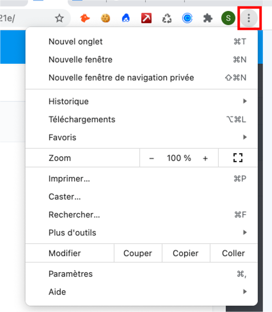
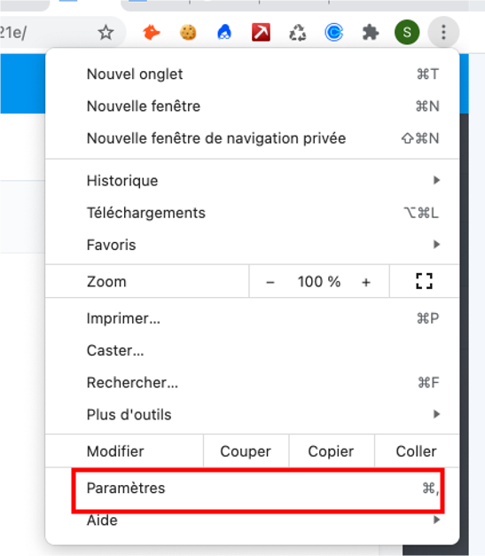
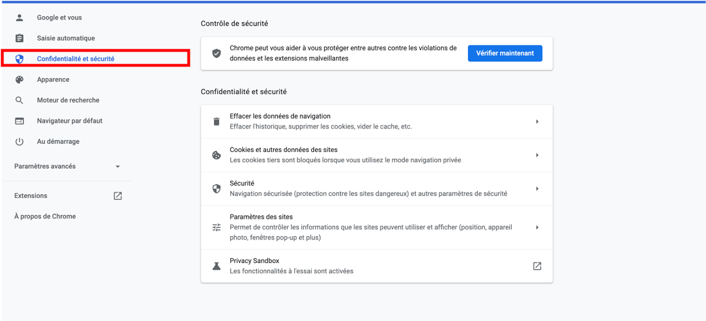
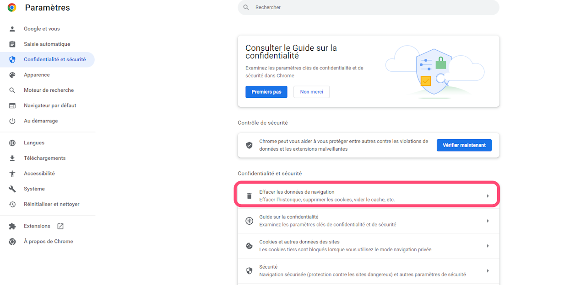
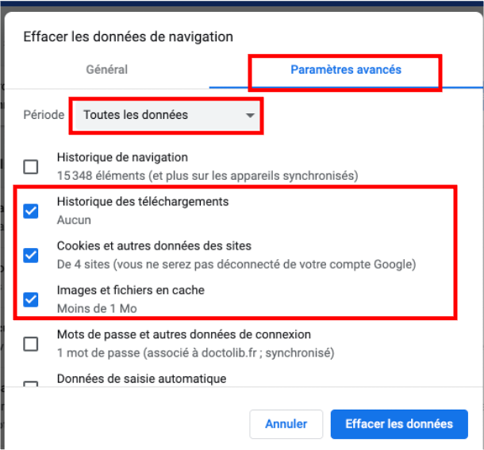
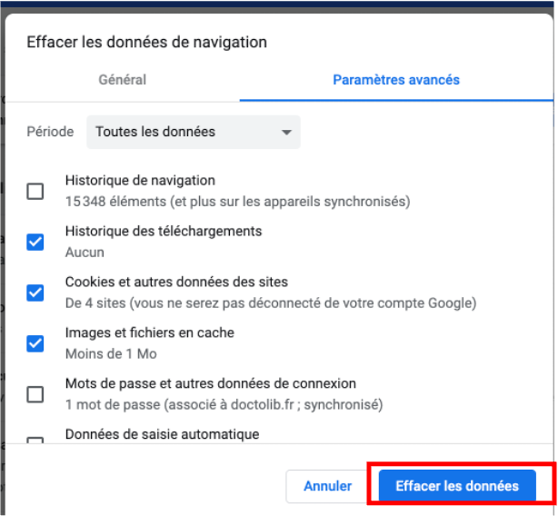
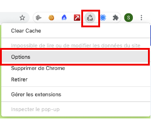
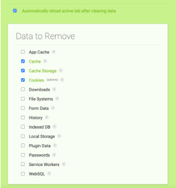
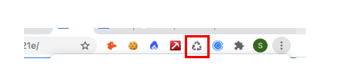

# Comment effacer ses cookies de navigation ?

Il est possible que vous rencontriez certains problèmes d'affichage ou de chargements à cause de l'accumulation de caches stockés par votre navigateur. Avant de contacter l'équipe de Qotid pour signaler un bug, nous vous conseillons de commencer par effacer vos cookies, puis de vider vos caches. Dans cet article, nous allons vous montrer comment effacer vos cookies selon deux méthodes :

## Méthode 1

* Cliquez sur les trois petits points en haut à droite de votre navigateur
* Cliquez sur le bouton "Paramètres"
* Cliquez sur "Confidentialité et sécurité"
* Cliquez sur "Effacer les données de navigation"
* Cliquez sur "Paramètres avancés" puis "Toutes les données". Assurez-vous que "Cookies et autres données des sites", "Images et fichiers en cache" est bien sélectionné
* Cliquez sur "Effacer les données"

## Méthode 2

Pour régler en un clic ces problèmes, vous pouvez télécharger cette extension de Google Chrome qui est entièrement gratuite :

[https://chrome.google.com/webstore/detail/clear-cache/cppjkneekbjaeellbfkmgnhonkkjfpdn](https://chrome.google.com/webstore/detail/clear-cache/cppjkneekbjaeellbfkmgnhonkkjfpdn)

* Faite un clic droit une fois installé pour cliquez sur "Option"
* Effectuer la configuration suivante en cliquant sur "Cache", "Cache Storage" et "Cookie" ainsi que sur la période "Everything"
* Une fois installée un simple clique sur l'extension réglera le souci.

