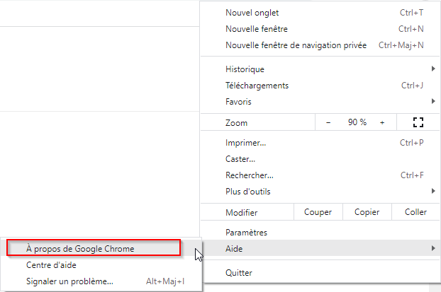
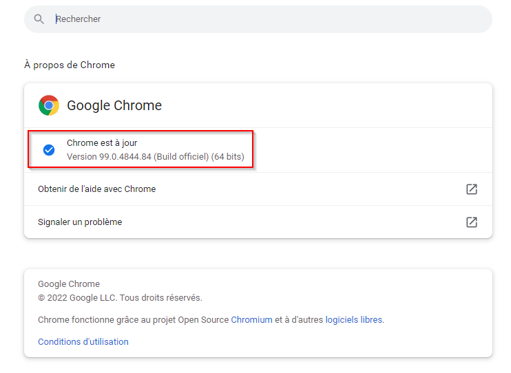

# Comment mettre à jour son navigateur Google Chrome ?

## Mise à jour de Chrome sur votre ordinateur

Il est important de régulièrement mettre à jour son navigateur web Google Chrome puisque votre expérience sur Qotid peut être affectée si vous n'êtes pas sur la dernière mise à jour de Google Chrome.

Pour ce faire, cliquez sur les 3 petits points sur la fenêtre de votre navigateur, puis sur "**Aide**" puis sur "**A propos de Google Chrome**".

