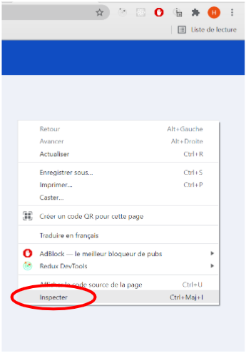
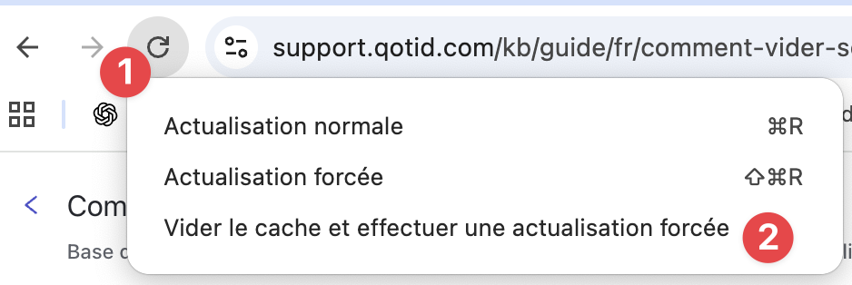
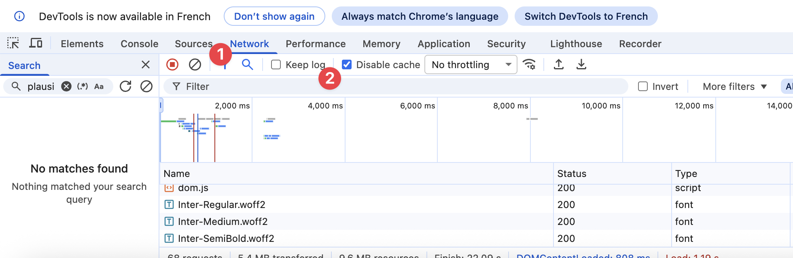

# Comment vider ses caches et faire une actualisation forcée ?

Actualiser vos caches et faire une actualisation forcée peut être utile si vous constatez des problèmes d'affichage.

Il existe deux solutions :

**À savoir :**

* La première solution est normalement suffisante et la plus simple à réaliser.
* Si ce n'est pas suffisant, vous pouvez également effacer vos cookies de navigation

## Méthode 1

Pour cela, connectez-vous sur votre interface Qotid puis :

* Faites un clic droit sur votre écran, et sélectionnez "Inspecter"

Maintenant :

* Faites un clic droit sur le bouton d'actualisation en haut à gauche de votre navigateur, et cliquez sur "Vider le cache et effectuer une actualisation forcée".

## Méthode 2

Pour cette méthode, vous devez être connecté sur Qotid :

* Faites un clic droit sur votre écran, et sélectionnez "Inspecter"
* Cliquez sur "Network"
* Cochez "Disable cache", puis faites la commande Ctrl + F5 (ou Ctrl + Fn + F5 selon votre clavier) ou Command + R
* Décochez "Disable cache".

