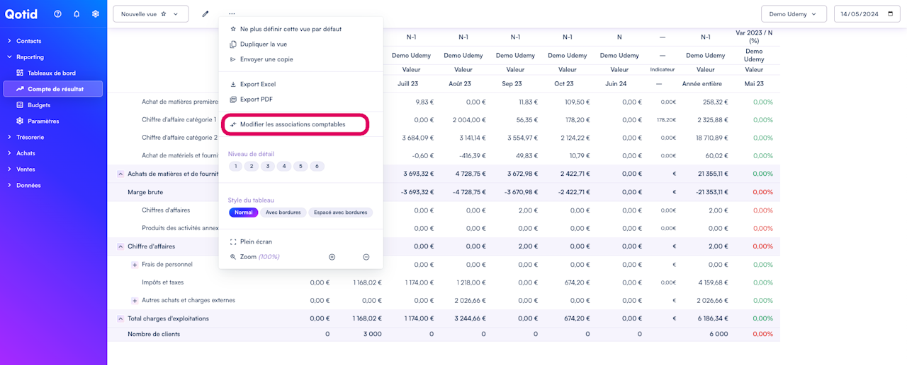
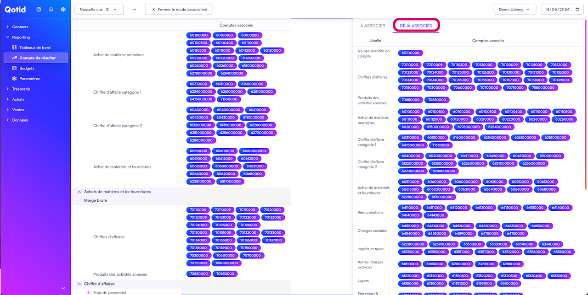
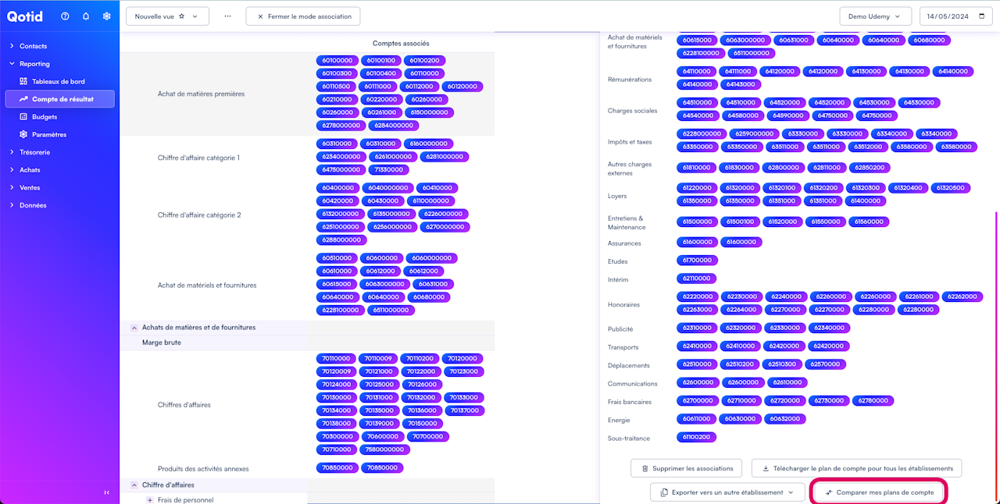

# Comment comparer vos plans de comptes entre établissements ?

## Accès à la comparaison des plans de compte

Attention seuls les utilisateurs qui ont le droit de modifier les associations comptables pourront réaliser les actions suivantes :

* Pour y accéder ; cliquer sur "**Plus d'actions**" depuis le compte de résultat puis sur "**Modifier les associations comptables**".
* Cliquer sur "**Déjà associés" puis sur "Comparer mes plans de compte**".

## Appliquer vos filtres

* Sélectionnez un groupe sur lequel vous souhaitez comparer vos établissements ou bien les établissements individuellement.
* Pour n'afficher que les différences, cochez "**Montrer uniquement les différences**".
* Enfin, cliquez sur "**Valider le filtre**".

## Résultat de la comparaison

Les différences s'affichent en rouge, vous pouvez comparer aisément vos établissements. Si vous le souhaitez, vous pouvez pour chaque établissement modifier les associations en cliquant sur le crayon en face du compte.

## Étape

