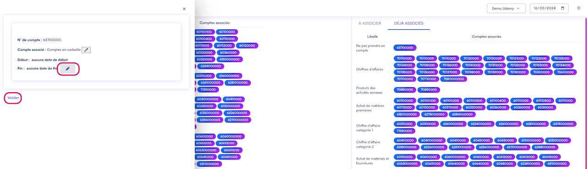
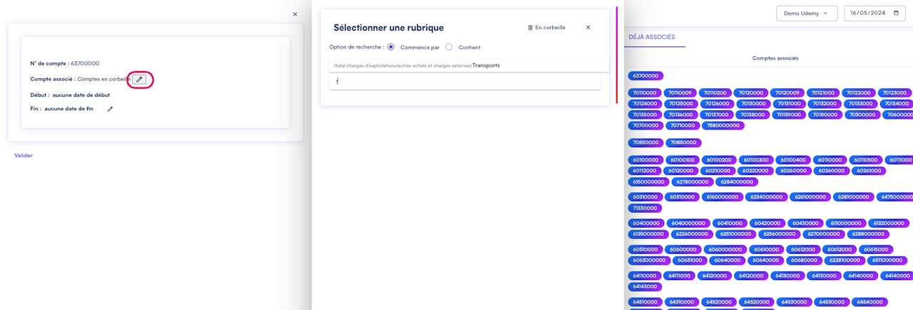

# Comment gérer mes cut-off comptable ?

## Introduction et accès aux cut-off

Vous souhaitez gérer vos cut-off sur les associations comptables, car vous vous retrouvez dans l'une de ces situations :

Premier cas : si un compte ne doit plus être utilisé et que vous souhaitez mettre une alerte sur celui-ci.

Deuxième cas : si un compte change d'affectation en cours d'exercice.

Avec Qotid, cela est maintenant à votre portée.

* Pour y accéder ; cliquer sur "Plus d'actions" depuis le compte de résultat puis sur "Modifier les associations comptables".
* Choisissez le compte qui vous intéresse en cliquant dessus.

## Mettre en place le cut-off

* Vous pouvez ajouter une date de fin à votre association qui sera la date de votre cut-off, pour cela, cliquez sur le crayon à côté de "aucune date de fin
* Cela vous crée une nouvelle association qui aura comme date de début, le lendemain de la date de fin de l'association précédente.
* Vous pouvez ainsi ajouter autant de cut-off que vous le souhaitez et pour chaque association, renseignez le compte dans lequel doit aller votre donnée. Pour rappel, il vous suffit de cliquer sur le pinceau à côté du compte associé puis de renseigner le compte que vous souhaitez associer.

Pour sauvegarder vos changements, cliquez sur "**Valider**". Sachez que "aucune date de fin" signifie que la fin est illimitée.
