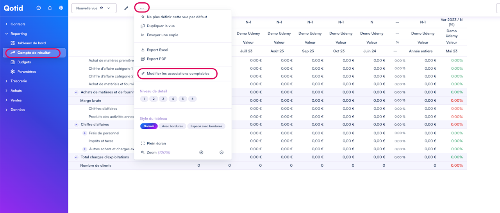

# Comment importer ou exporter vos associations comptables vers un autre établissement ?

## Aller dans compte de résultat

Lorsque vous accédez au module compte de résultat, vous avez la possibilité d'exporter les associations comptables d'un établissement vers un autre en quelques clics. Cette possibilité est réservée aux utilisateurs qui sont autorisés à le faire par leur administrateur de compte.

* Pour y accéder ; cliquer sur "Plus d'actions" depuis le compte de résultat puis sur "Modifier les associations comptables".

## Association comptable vers d'autres établissements

* Cliquer sur "Déjà associés" puis sur "Exporter vers un autre établissement". Si vous n'avez pas commencé à associer de compte vous aurez la possibilité d’importer depuis un autre établissement.

## Sélectionner les établissements

*   Sélectionner l'établissement vers lequel vous souhaitez exporter ou importer votre table d'association.

    **Attention :**

    **Attention** : Si l'établissement vers lequel vous exportez votre table d'association possède déjà des associations, celles-ci seront écrasées et remplacées par la nouvelle table d'association que vous exportez.
