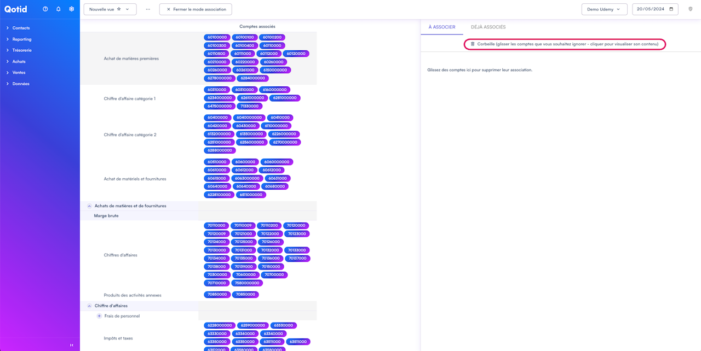

# Comment placer en corbeille un compte pour ne pas le prendre en compte dans mon reporting ?

## Placer un compte en corbeille

À partir de votre compte de résultat, il est possible de retirer un de vos comptes afin qu'il ne soit pas pris en compte dans votre reporting.

Pour réaliser cette tâche, il vous faut glisser le compte dans la corbeille comme présenté ci-contre.
