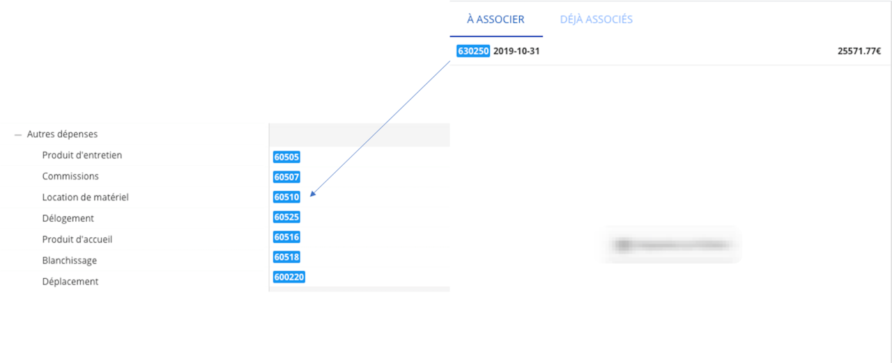
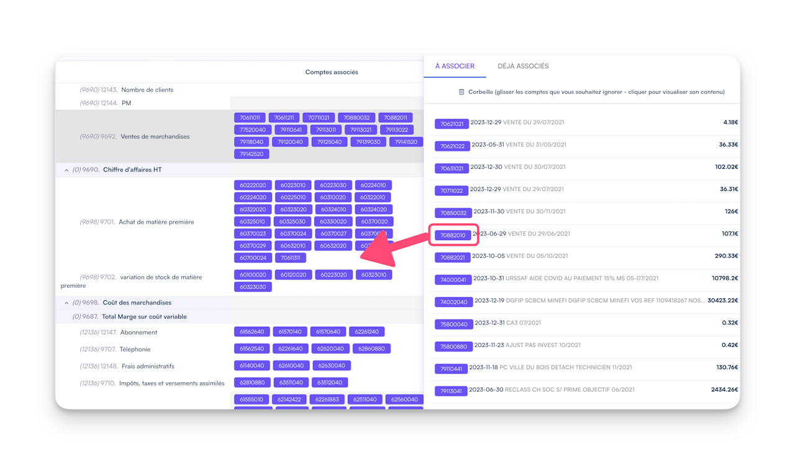
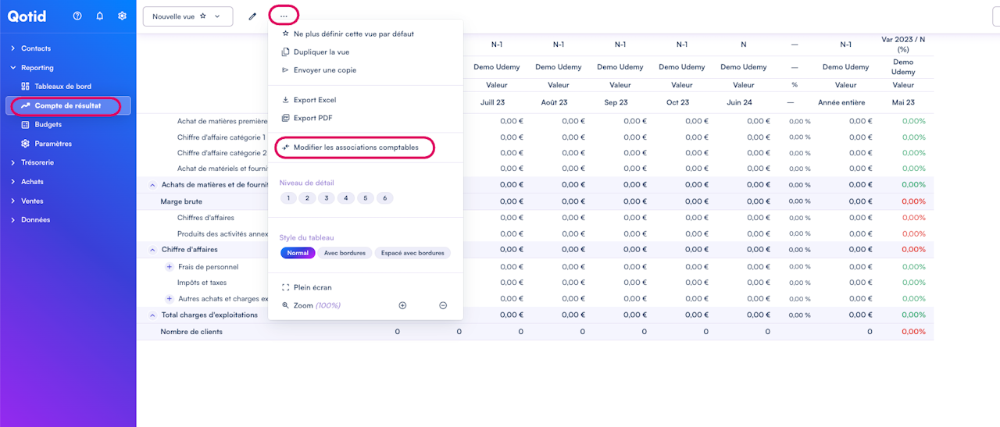

# Comment réaliser ou modifier les associations comptables ?

## Réaliser une association comptable

Lorsque vous accédez au Module Compte de résultat, vous avez la possibilité de gérer les associations comptables afin d'alimenter votre compte de résultat.

* Pour y accéder ; cliquer sur "**Plus d'actions**" depuis le compte de résultat puis sur "**Modifier les associations comptables**"..

**Attention :**

Cette possibilité est réservée aux utilisateurs administrateurs ou aux utilisateurs autorisés par leur administrateur de compte.

## Glisser déposer vos numéros de comptes comptable

Une fois sur cette page vous pouvez simplement glisser déposer les numéros de comptes que vous souhaitez associer vers les rubriques de votre reporting.

**À savoir :**

Si vous êtes sur un compte multi-sociétés vous pouvez ensuite dupliquer votre plan de compte vers les autres sociétés. Cliquez sur le bouton ci-dessous pour en savoir plus.

## Comment importer ou exporter vos associations comptables vers un autre établissement ?

Consultez également le guide [Comment importer ou exporter vos associations comptables vers un autre établissement ?](comment-importer-ou-exporter-vos-associations-comptables-vers-un-autre-etablissement.md).

## Fin du guide
