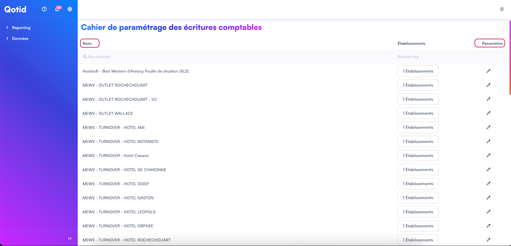
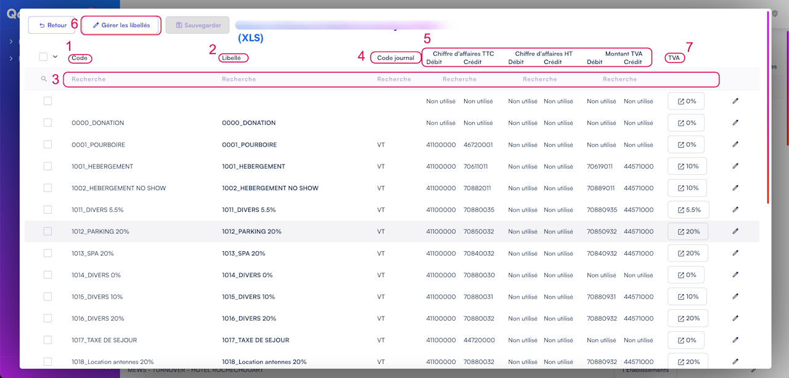
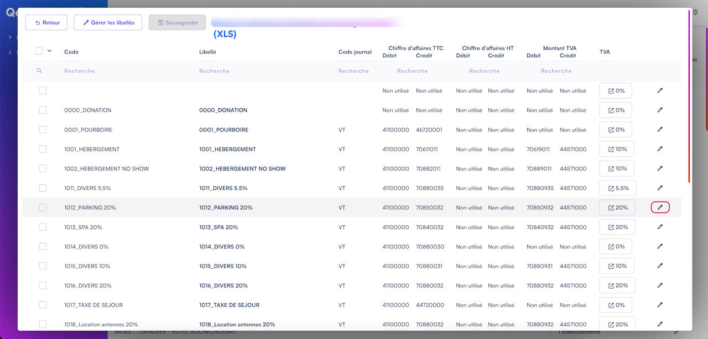
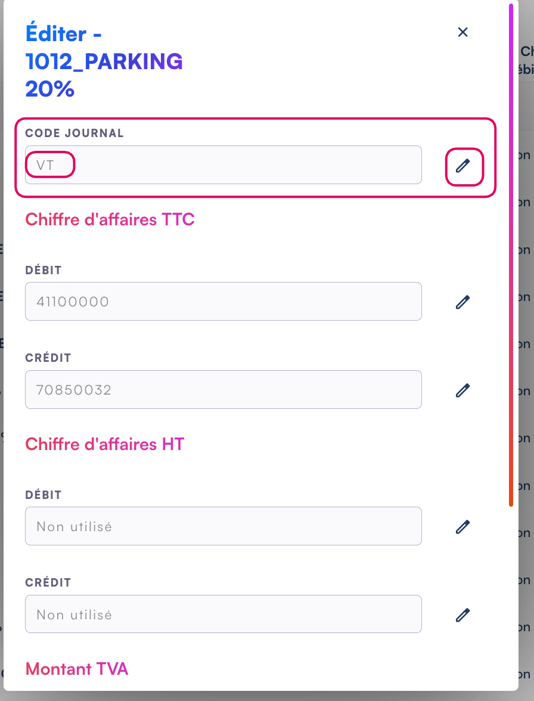
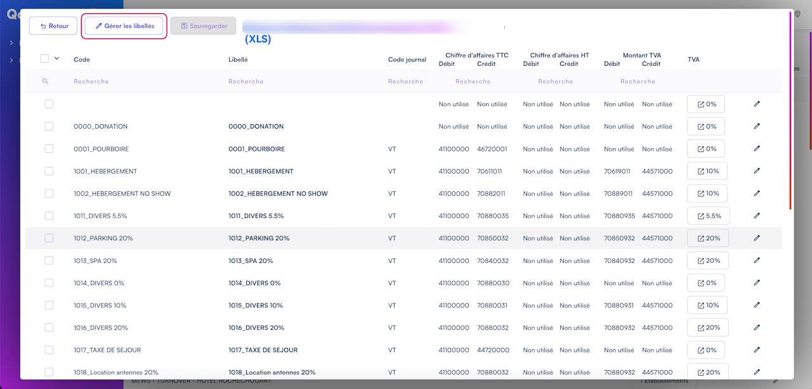
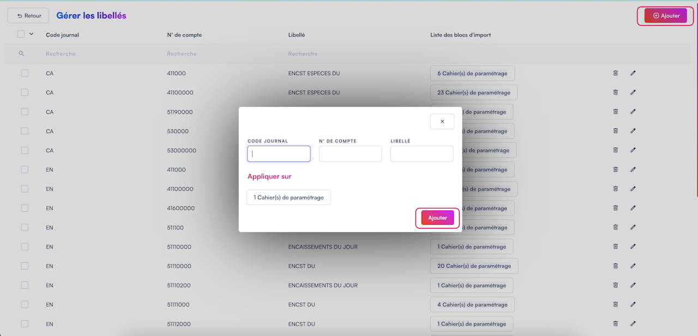

# Comment paramétrer les cahiers de paramétrages des écritures comptables de vos logiciels externes ?

## Accéder au cahier de paramétrage

Pour accéder au cahier de paramétrage des écritures comptables de vos logiciels externes, il faut cliquer sur "**Paramètres"** (la roue crantée) puis sur "**Cahier de paramétrage des écritures comptables".**

**Attention :**

Vous devez avoir un module payant spécifique pour visualiser ce module. Contactez votre support client pour plus d'informations.

## Cahier de paramétrage des écritures comptables

Une fois sur cette page vous trouverez la liste de tous vos cahiers de paramétrages via lesquelles nous générons des écritures comptables.

Il vous suffit d'appuyer sur le pinceau pour accéder au cahier et pouvoir le modifier.

**Chemin : Revenir au début**

## Présentation du cahier de paramétrage

Une fois le cahier de paramétrage ouvert, vous trouverez :

1. Dans la première colonne vous trouverez chaque identifiant unique issu de votre logiciel qui vous permettra de comprendre la nature du produit. Il s'agit soit d'un code produit, nom de produit unique, etc
2. Dans la seconde vous retrouverez les libellés de ces codes. Ce champs est utile notamment lorsque nous récupérons un code produit sous forme d'identifiant unique
3. Une barre de recherche vous permet de rechercher des codes via leur libellé
4. Dans la colonne suivante, vous avez le code journal que vous serez amené à définir
5. Dans les colonnes suivantes vous retrouverez les différents éléments pour lesquelles nous générons des écritures comptables (Montant TTC, Montant HT, Montant TVA). Vous devrez pour chacun définir l'écriture à générer en débit ou crédit selon les méthodes de comptabilisation de votre établissement.
6. Le bouton **Gérer les libellés** vous permet de définir un libellé unique pour chaque compte comptable et du code journal. Ce libellé sera disponible dans votre extraction comptable et est obligatoire.
7. Enfin, vous retrouvez le taux de TVA. Si vous cliquez sur le symbole juste devant, vous serez ramené au cahier de paramétrage des logiciels externes.

**À savoir :**

N'hésitez pas à utiliser la barre de recherche pour faire des recherches et des modifications en masse sur plusieurs lignes.

**Chemin : Modification des écritures comptables**

## Sélectionner une valeur à modifier dans le paramétrage des écritures comptables

Pour modifier une écriture comptable, il suffit de cliquer sur le crayon en face de l'écriture à modifier.

## Modification des écritures comptables dans le cahier de paramétrage

Pour indiquer le compte comptable que vous souhaitez utiliser il suffit de cliquer à nouveau sur le crayon puis d'indiquer le numéro de compte dans le champ **Valeur.**

Si ce code de transaction n'est pas à prendre en compte et que vous n'avez pas besoin de générer une écriture comptable vous pouvez utiliser le bouton **Non utilisé.**

Ensuite il suffit de **Valider**

**Chemin : Modification du code journal**

## Modification du code journal dans le cahier de paramétrage

Pour modifier le code journal à générer sur un code de transaction il suffira de cliquer sur le pinceau et d'indiquer le code journal souhaité

## Validation de votre paramétrage

Il faut ensuite se rendre tout en bas de la pop up pour **Valider.**

**Attention :**

Attention : lorsque vous modifiez un élément, cela va modifier l'intégralité de l'historique sur les établissements attachés au cahier de paramétrage

**Chemin : Modification des libellés comptables**

## Renseignez les libellés des différents codes

Pour ajouter ou modifier vos libellés comptables il suffit de cliquer sur "Gérer les libellés" en haut à gauche.

## Ajouter un libellé

Pour ajouter un nouveau libellé, il suffit de cliquer sur **Ajouter** puis de saisir le code journal, numéro de compte et libellé que vous souhaitez.

**Attention :**

Chaque libellé doit être unique en fonction d'un code journal et numéro de compte. Dans ce cas, si vous avez pour le même code journal et numéro de compte, deux libellés différents Qotid prendre un des deux libellés de manière aléatoire.

## Modifier ou supprimer un libellé existant

Vous avez également la possibilité de modifier ou supprimer un libellé existant.

## Alerte sur libellé manquant

Veuillez noter que lorsqu'un libellé est manquant, une alerte apparait dans votre cahier de paramétrage
