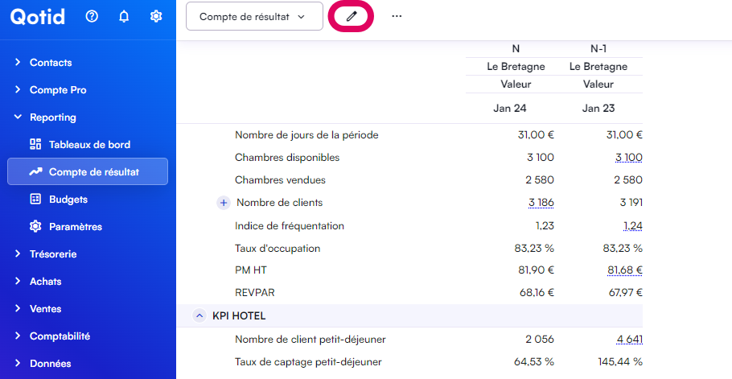
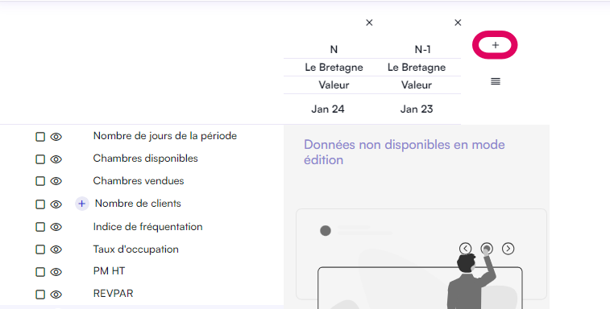
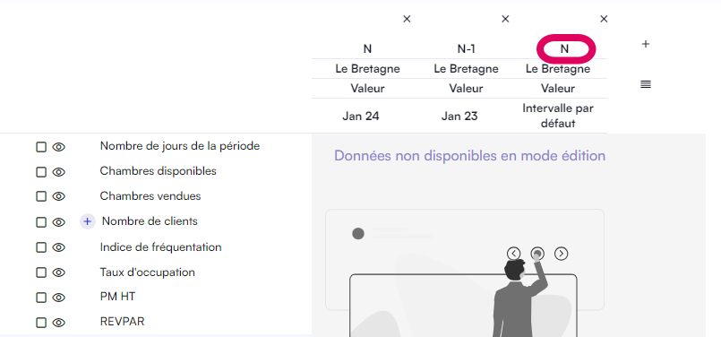
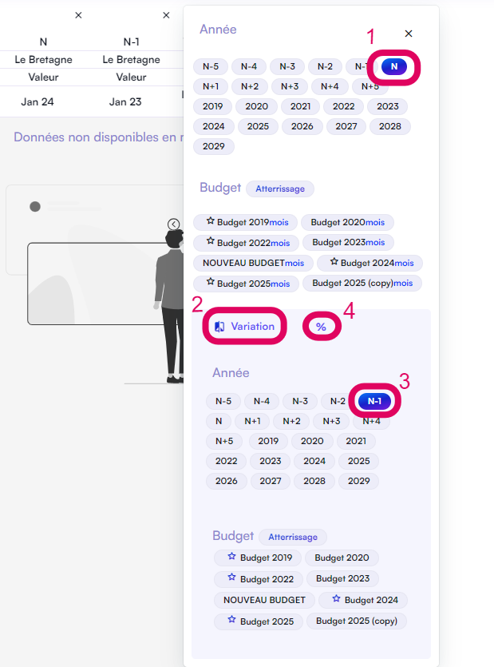
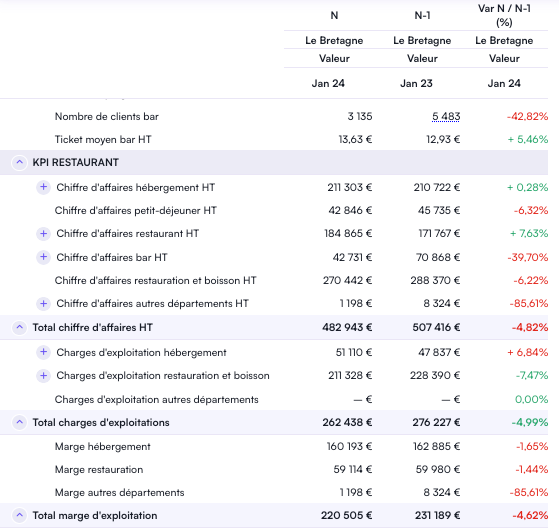

# Comment créer une colonne calculant les variations dans vos reportings ?

## Activer le mode édition

Dans votre compte de résultat vous pouvez créer une colonne qui contient une variation en % ou en valeur.

Dans cet exemple, nous avons affiché une colonne avec les données de Janvier de l'année N et une autre avec les données de Janvier N-1.

Nous souhaitons créer une troisième colonne qui contient la variation en % de ces deux données.

Pour cela, il suffit de cliquer sur le stylo en haut de l'écran pour activer le mode édition.

## Ajouter une colonne

Cliquez ensuite sur le bouton "+" pour ajouter une nouvelle colonne.

## Paramétrer le type de donnée

Cliquez ensuite sur le "N" pour paramétrer le type de donnée que vous souhaitez afficher.

## Créer une variation

Sélectionnez la valeur "N" puis cliquez sur "Variation" et sélectionnez la valeur avec laquelle vous souhaitez calculer la variation (Année ou Budget).

Dans cet exemple nous sélectionnons la donnée N-1.

**Cliquer sur le bouton "%" si vous souhaitez afficher la variation en pourcentage, par défaut la variation sera affichée en valeur.**

## Afficher une variation

Votre compte de résultat affiche désormais la variation entre la donnée N et N-1.
