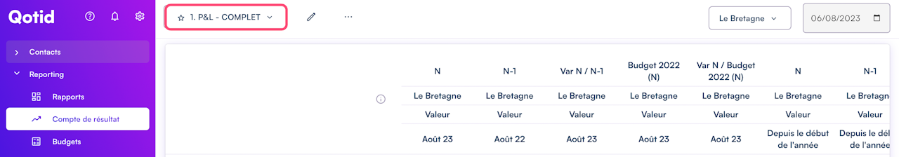
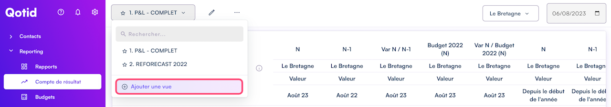
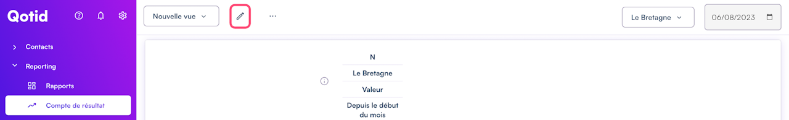

# Comment créer une nouvelle visualisation sur votre compte de résultat ?

## Se rendre sur le compte de résultat

Lorsque vous accédez au module "**Compte de résultat**", vous avez la possibilité de créer autant de vues que vous le souhaitez en fonction des analyses que vous souhaitez effectuer.

Cette possibilité est réservée aux utilisateurs qui sont autorisés à le faire par leur administrateur de compte.

## Liste des vues

Pour commencer, cliquez sur le bouton en haut à gauche pour afficher la liste des vues auxquels vous avez accès.

**À savoir :**

Les vues avec une étoile devant sont des vues définies comme étant par défaut.

## Créer une vue

Ensuite, cliquez sur "**Ajouter une nouvelle vue**".

## Nouvelle vue

Vous êtes alors immédiatement déplacé sur votre nouvelle vue, vous avez alors la possibilité d'éditer sur mesure votre rapport de gestion grâce au pinceau.
