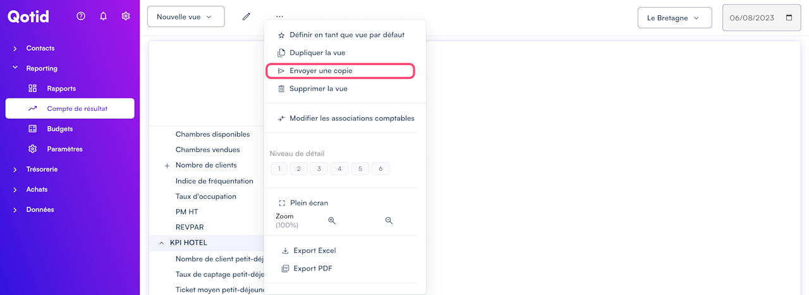

# Comment envoyer une copie d'une de vos vues à vos collaborateurs

## Comment envoyer une copie d'une de vos vues à vos collaborateurs

Tous les utilisateurs aillant accès au compte de résultat auront la possibilité d'envoyer une copie d'une de leurs vues à leurs collaborateurs.

Il est important de noter que contrairement au partage de vues par défaut, envoyer une copie ne va pas synchroniser les différentes vues, vous ne pourrez donc pas voir les modifications effectuées par vos collaborateurs

## Choix de la vue

Pour commencer, positionnez-vous sur la vue que vous souhaitez envoyer puis cliquez sur "**Plus d'action**"et"**Envoyer une copie**".

## Choix des utilisateurs

Vous verrez apparaître sur la gauche une liste d'utilisateurs. Vous pouvez sélectionner dans cette liste les utilisateurs auxquels vous souhaitez envoyer une copie de la vue en question ou de rechercher directement dans la barre de recherche le nom de la personne à qui vous souhaitez envoyer une copie.

## Valider l'envoi

Pour finir, cliquez sur "**Envoyer**", les utilisateurs recevront un email leur indiquant que vous leur avez partagé la vue.
