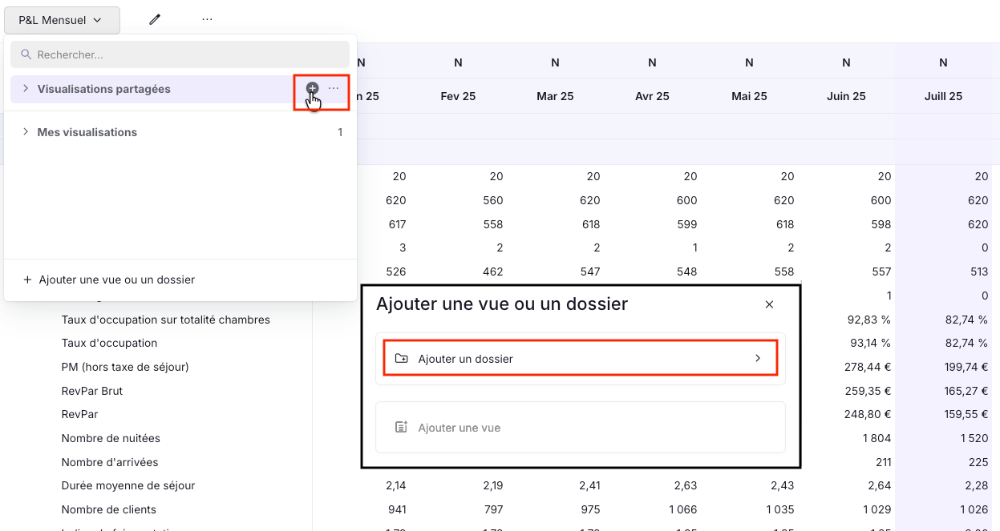
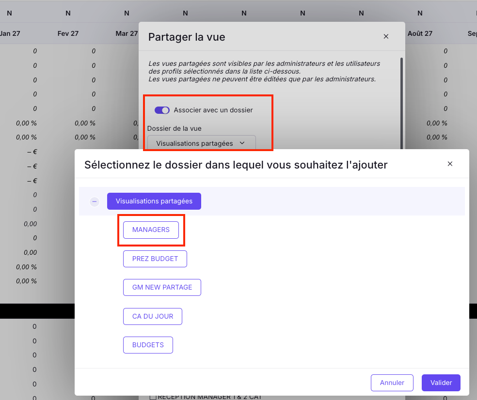

# Comment organiser vos vues par dossier ?

## Comment organiser vos vues par dossier ?

Vous pouvez organiser vos vues par dossier.

Cliquer sur **+** puis "**Ajouter un dossier**"

## Organisation des dossiers

Vous pouvez ensuite "glisser" la vue dans le dossier.

**Attention :**

Le profil utilisateur aura accès au **dossier** dans le menu des vues, ainsi qu’aux **vues partagées** qu’il contient — mais **uniquement** à celles qui lui ont été effectivement partagées (les autres vues du dossier resteront invisibles).

## Sélection des profils

Une fenêtre s'ouvre alors, dans cette fenêtre, vous pouvez sélectionner les profils à qui partager votre vue.

Sélectionner les profils désirés puis cliquez sur **Valider.**

La vue sera partagée à tous les utilisateurs de profils ainsi que ceux qui y seront ajoutés dans le futur.

## Comment consulter le partage d'une vue ?

Pour consulter les profils qui sont partagés, en face de la vue, cliquer sur l'icône utilisateurs. une fenêtre s'ouvre avec tous les profils partagés.

## Comment modifier le partage d'une vue ?

Pour modifier les profils auxquels une vue est partagée, en face de la vue, cliquer sur **...**

Une fenêtre s'ouvre alors avec la liste de tous les profils actuellement partagés : vous pouvez sélectionnez ou désélectionnez les profils souhaités pour ajuster le partage.
