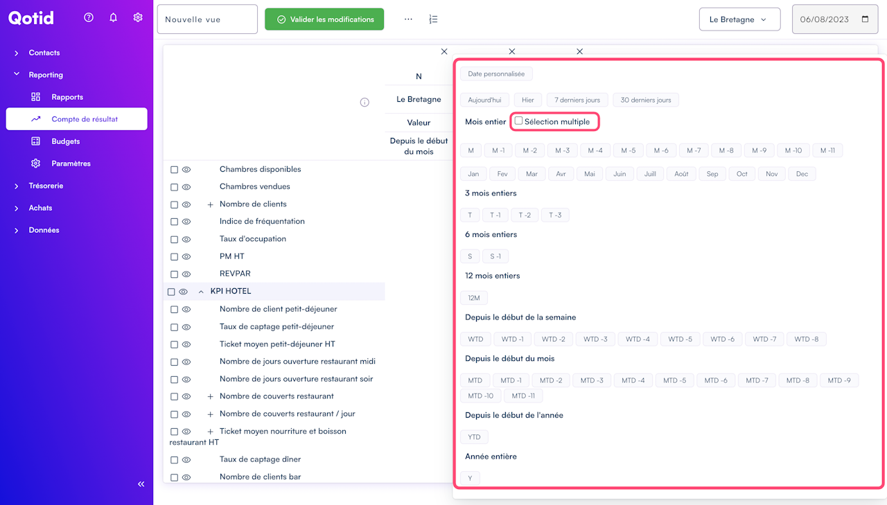
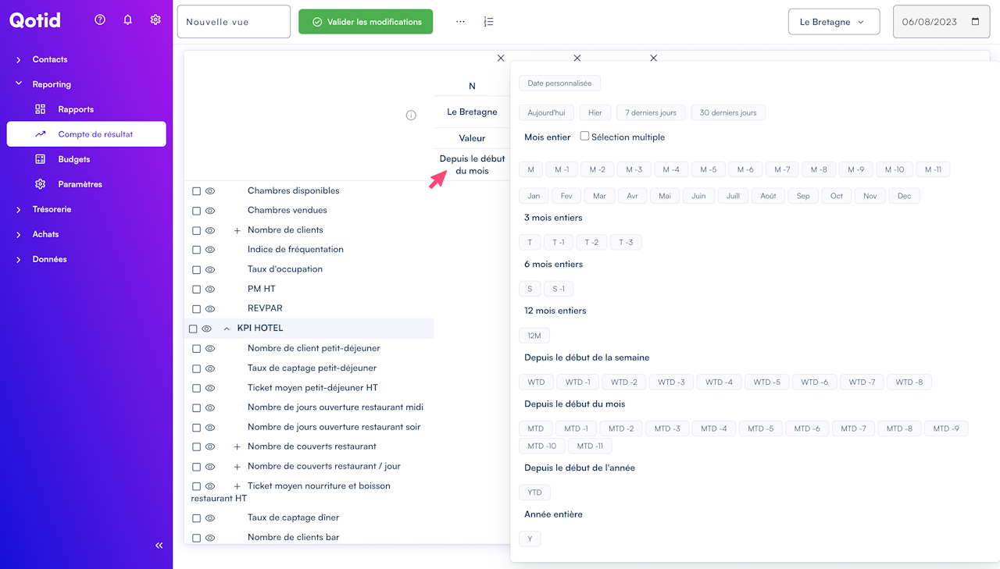
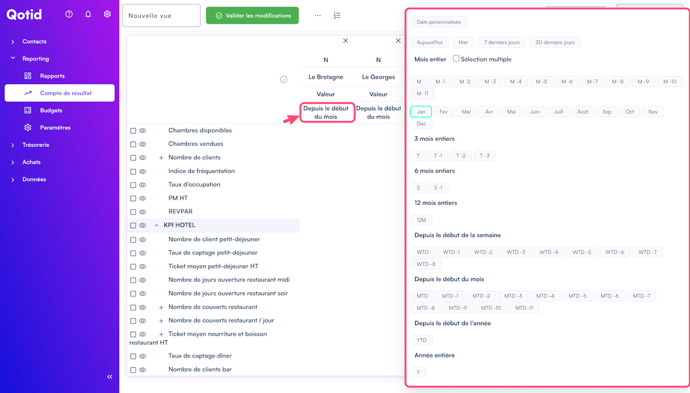

# Comment sélectionner une période dans une colonne de votre P\&L ?

## Comment sélectionner une plage de date dans une colonne de votre P\&L

Depuis votre compte de résultat, vous avez la possibilité une période de manière statique ou dynamique ou faire un mix entre statique et dynamique. Nous vous expliquons tout cela :

Dans un premier temps, vous devez cliquer sur la ligne permettant de choisir une plage de date comme ci-dessous.

## Sélectionner la période

Une fois dans l'onglet de sélection d'intervalle, vous pouvez sélectionner plusieurs périodes :

De manière dynamique par rapport à la date de fin en haut à droite :

* **Aujourd'hui**
* **Hier**
* **7 derniers jours** : jusqu'à date de fin sélectionnée en haut à droite de manière dynamique
* **Mois entier** : 1er jour du mois jusqu'à dernier jour du mois en fonction de la date sélectionnée en haut à droite de manière dynamique
* **Depuis le début de l'année (YTD)** : Depuis le 1er Janvier à date sélectionnée en haut à droite de manière dynamique
* **6 derniers mois entiers** : jusqu'à date de fin sélectionnée en haut à droite de manière dynamique
* **12 derniers mois entiers** : jusqu'à dernier jour du mois de la date de fin sélectionnée en haut à droite de manière dynamique
* Etc.

De manière statique :

* En sélectionnant un mois en dur. Janvier, Février, etc...

## Sélection de période plus avancée

Vous pouvez également sélectionner une période sur une date personnalisée ou sélectionner une période sur une plage de date avec un mix entre période statique et dynamique.

## Comment sélectionner une plage de date dans une colonne de votre P\&L

Consultez également le guide [Comment sélectionner une plage de date dans une colonne de votre P\&L](https://support.qotid.com/kb/fr/).

## Comment réaliser une date personnalisée sur une vue de votre compte de résultat?

Consultez également le guide [Comment réaliser une date personnalisée sur une vue de votre compte de résultat?](https://support.qotid.com/kb/fr/).
