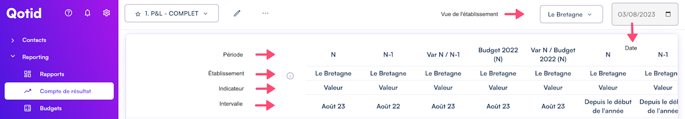
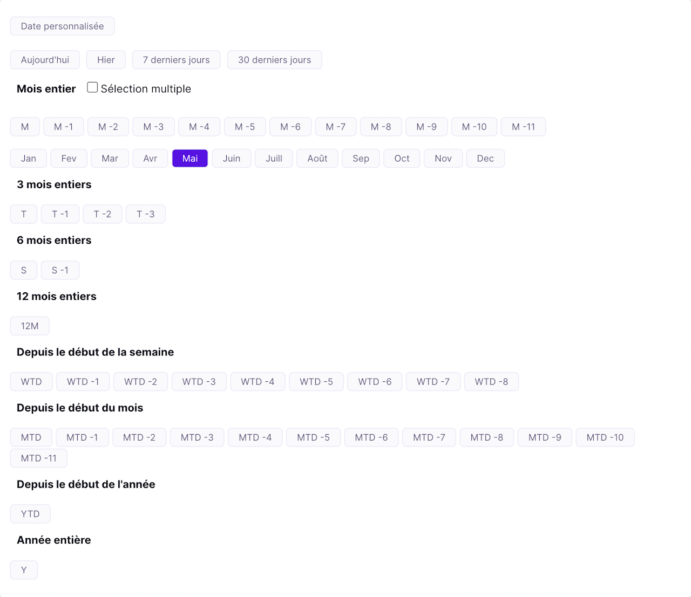
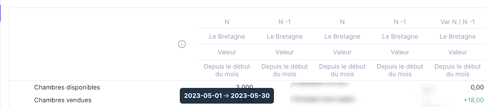

# Présentation du module Compte de résultat

## Introduction

Le module **Compte de résultat** vous permet d'accéder à votre compte de résultat qui a été personnalisé pour vous lors de la création de votre compte. Sur cet espace, vous pourrez créer autant de tableaux de bord personnalisés que vous le souhaitez et effectuer un grand nombre d'analyses approfondies :

* Analyse mensuelle, semestrielle, trimestrielle, hebdomadaire
* Analyse par KPIs (indicateur clé de performance)
* Comparaison de la performance de vos établissements (pour les comptes multisites)
* Et bien plus encore.

## Principe général

Voici une présentation de Qotid lorsque vous accédez à votre compte de résultat :

## Paramétrage de la date

Cet onglet vous permet de sélectionner la date de fin selon l'intervalle sélectionné. Ici les chiffres récupérés s'analyseront toujours avec une date de fin.

## Paramétrage de l'établissement

Permet de sélectionner l'établissement dont vous souhaitez afficher les données. Si vous êtes propriétaires multisites, vous pouvez créer et sélectionner vos consolidés en cliquant ce bouton.

## Paramétrage de l'intervalle

En fonction de la Date sélectionnée, vous pouvez choisir un intervalle sur les données que vous souhaitez afficher. Il existe plusieurs intervalles possibles : Mois entier, 3 derniers mois entiers, 6 derniers mois entiers, Depuis le début de la semaine, Depuis le début du mois, Depuis le début de l'année. Exemple : La Date sélectionnée sur Qotid est le 31/12/2021. Sur votre compte de résultat, vous sélectionnez un intervalle "**Depuis le début du mois**". Qotid affichera la donnée récupérée correspondant à la période entre le 1er décembre 2021 et le 31 décembre 2021. Si vous avez un doute, vous pouvez passer la souris et l'intervalle s'affichera sur votre écran.

## Paramétrage du format de la donnée

Dans la colonne sélectionnée, ce bouton vous permet de définir sous quel format vous souhaitez afficher vos données :

* **Valeur** : il s'agit d'un format brut récupéré depuis vos systèmes
* **Indicateur** : il s'agit d'une analyse par KPIs, vous pouvez retrouver dans notre autre guide, comment analyser votre compte de résultat sous forme de KPIs
* **% du CA** : il s'agit d'une analyse en fonction de votre chiffre d'affaires.

## Paramétrage de l'établissement

Cet onglet permet de sélectionner un établissement autre que celui sélectionné en haut et droite de votre écran. Si vous laissez le bouton en "établissement par défaut", lorsque vous changerez d'établissements les données se mettront automatiquement à jour. Si vous choisissez un établissement précis, les données seront bloquées sur l'établissement sélectionné. Pour plus d'informations n'hésitez pas à regarder commet réaliser un benchmark de vos établissements.

## Paramétrage de la date

Cet onglet permet de sélectionner la donnée que vous souhaitez afficher en fonction de la Date sélectionnée :

* N : Année en cours
* N-1 : Année en cours - 1. Dans notre exemple, il s'agit de 2018.
* N-2 : Année en cours - 2. Dans notre exemple, il s'agit de 2017.
* En sélectionnant Variation vous pouvez afficher directement dans la colonne une variation entre N et N-1 et ou votre budget.
* En sélectionnant Variation et %, vous pouvez afficher directement dans la colonne une variation en pourcentage entre N et N-1 et ou votre budget.
* Si le module budget est activé sur votre espace, vous pouvez également choisir d'afficher des données spécifiques à l'un de vos budgets et de faire un atterrissage.

## En savoir plus sur le compte de résultat

Avez-vous d'autres interrogations sur le compte de résultat

Pour créer de nouvelles vues : [Comment créer une nouvelle vue de votre compte de résultat ?](comment-creer-une-nouvelle-visualisation-sur-votre-compte-de-resultat.md) Pour modifier une vue : [Comment éditer ou modifier une vue de votre compte de résultat ?](comment-editer-ou-modifier-une-vue-de-votre-compte-de-resultat.md) Pour exporter vos données : [Comment exporter vos données (Compte de Résultat) ?](comment-exporter-vos-donnees-sous-format-excel.md) Pour définir une vue par défaut : [Comment définir un compte de résultat par défaut ?](https://app.crisp.chat/fr/article/comment-definir-un-compte-de-resultat-par-defaut-sr13al/)
