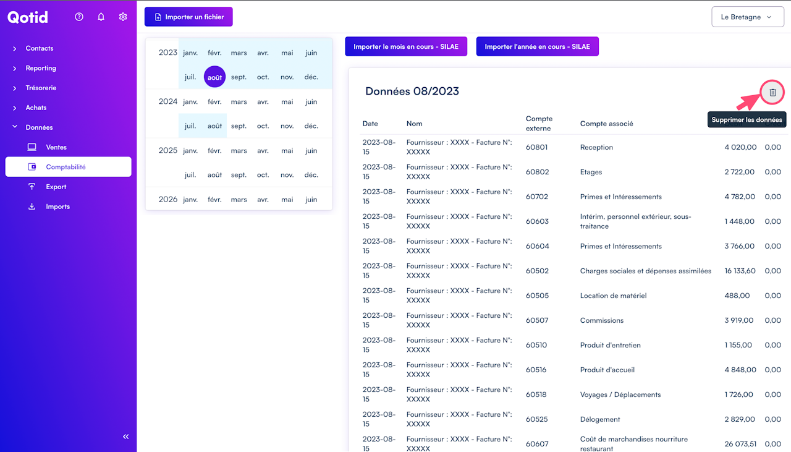

# Comment supprimer vos données comptables et éviter les doublons lors de l'import de vos données comp

## Eviter les doublons

Si le grand livre que vous souhaitez importer contient des dates sur lesquelles vous avez déjà importéz des données via un autre grand livre. il faudra supprimer les données présentes sur le/les mois concernés avant d'importer votre GL. Les mois surlignés en bleu dans le calendrier contiennent des données.

Pour cela, dans "**Données**" puis **"Comptabilité"** plaçez-vous sur une date sur le calendrier à gauche. Puis cliquer sur la poubelle en haut à droite. Enfin, sélectionner la période que vous voulez supprimer:

-supprimer toutes les données de ce mois -supprimer toutes les données de cette année
