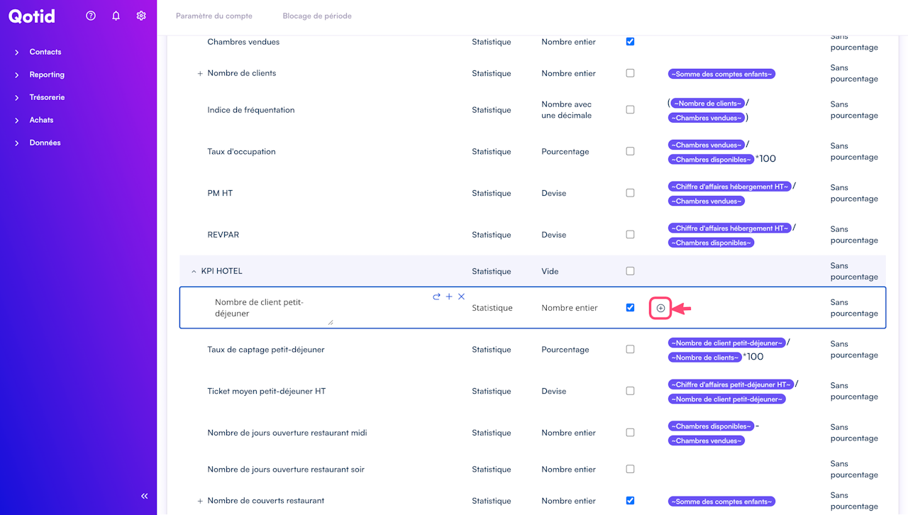

# Ajouter des calculs spécifiques sur vos rubriques et sous-rubriques

## Où Saisir un calcul

Sur l'ensemble de vos rubriques, vous aurez probablement besoin de saisir des calculs.

Par exemple pour un prix moyen si vous avez déjà la rubrique Quantité et la rubrique Chiffre d'affaires de créée, il est préférable d'aller calculer ce prix moyen plutôt que d'aller récupérer ou saisir cette donnée.

Sur Qotid, vos rubriques sont automatiquement paramétrées pour être la somme des sous-rubriques. Cependant vous pouvez forcer un calcul selon vos besoins. Pour cela il suffit de cliquer sur "**Ajouter un calcul**".

## Saisir un calcul

Si votre calcul est la somme, la différence, la division ou la multiplication entre plusieurs autres rubriques de votre modèle de reporting, il faudra cliquer sur "**Ajouter un compte**" et via une saisie vous pourrez récupérer les comptes qui vous intéressent.
