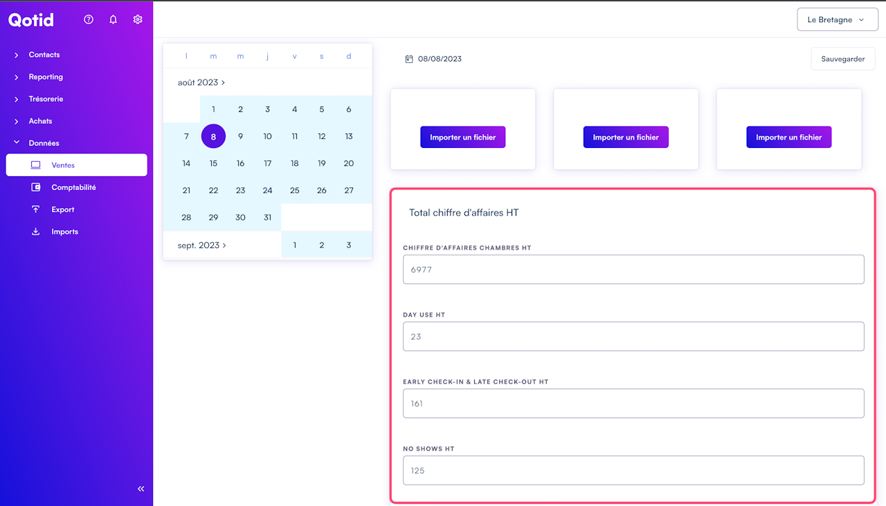
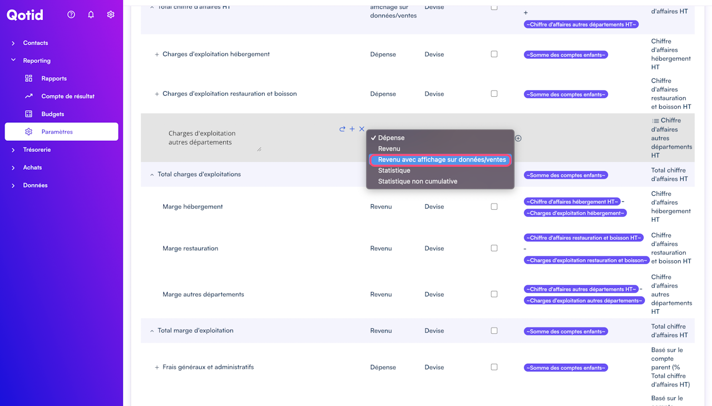

# Comment afficher vos points de données dans DONNEES / VENTES pour pouvoir saisir manuellement des in

## Affichage via le choix du type de la rubrique

Pour afficher vos données dans "**DONNÉES / VENTES**" Vous devrez vous rendre dans le paramétrage de votre P\&L. (Voir Introduction au paramètre P\&L lors du choix de l'étape suivante) Pour afficher les données à cet endroit et avoir la possibilité de saisir manuellement des informations ou voir les données s'implémenter directement après un import de fichier vous devrez paramétrer le type de votre point de donnée en type **statistiques** ou **revenu avec affichage sur données/ventes.** (Voir Paramétrer vos rubriques selon le type et le mode d'affichage souhaités lors du choix de l'étape suivante)

Il est important de noter que :

* Le compte parent doit également être de type statistiques ou en revenu avec affichage sur données/ventes pour que la donnée soit affichée.
* Les points de données contenant des calculs ne seront pas affichés même s'ils sont de type statistiques ou en revenu avec affichage sur données/ventes.

## 1. Introduction au paramètre P\&L

Consultez également le guide [1. Introduction au paramètre P\&L](introduction-au-parametre-p-and-l.md).

## Fin du guide

## 3. Paramétrer vos rubriques selon le type et le mode d'affichage souhaités

Consultez également le guide [3. Paramétrer vos rubriques selon le type et le mode d'affichage souhaités](parametrer-vos-rubriques-selon-le-type-et-le-mode-daffichage-souhaites.md).

## 1. Introduction au paramètre P\&L

Consultez également le guide [1. Introduction au paramètre P\&L](introduction-au-parametre-p-and-l.md).
