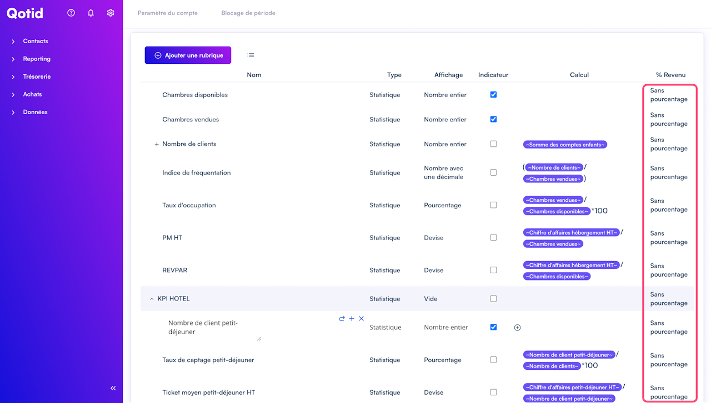
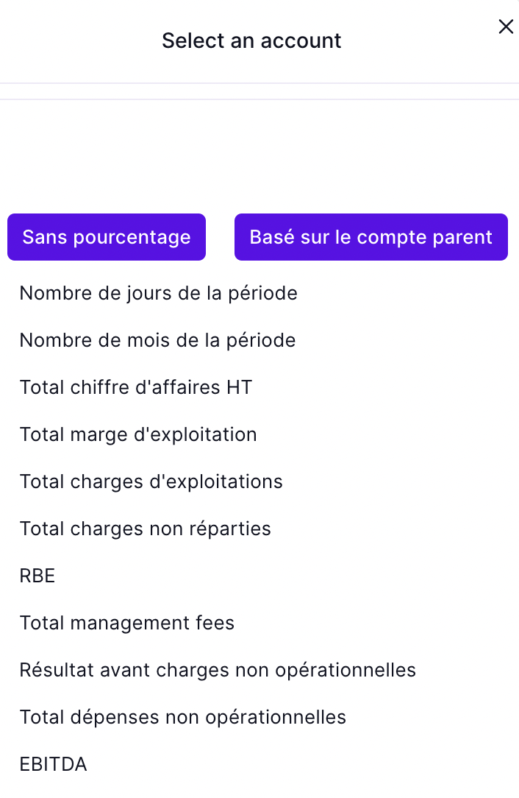

# Comment définir l'affichage % Revenu ?

## Comment définir l'affichage

Dans votre Compte de Résultat, vous pourrez afficher vos données sous forme de % Revenu. Pour paramétrer au travers de quelle rubrique vous souhaitez que le % de Revenu se calcule, il suffit de sélectionner le bon % dans la colonne "**% Revenu**" Une fenêtre s'ouvrira et vous pourrez définir la rubrique comme :

* **Sans pourcentage :** Aucun % de Revenu ne sera visible sur le Compte de Résultat. Noter que la rubrique sera automatiquement en sans pourcentage si le type de donnée est statistique ou statistique non-cumulative.
* **Basé sur le compte parent :** Le % de Revenue sera automatiquement basé sur le compte parent. Si le compte parent est aussi basé sur le compte parent, le système continuera de remonter jusqu'au premier niveau de la rubrique principale.
* **Basé sur une rubrique :** Dans ce cas, il suffit de sélectionner dans la liste la rubrique sur laquelle vous souhaitez baser le calcul du % Revenue et de cliquer sur "**Sélectionner ce compte**".
