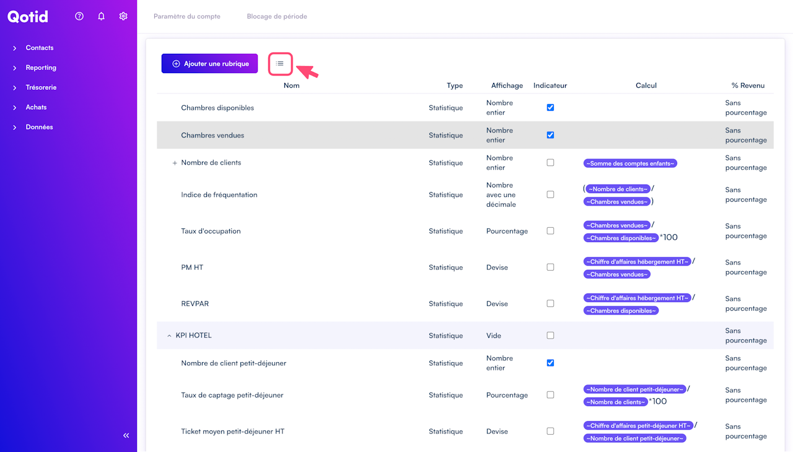
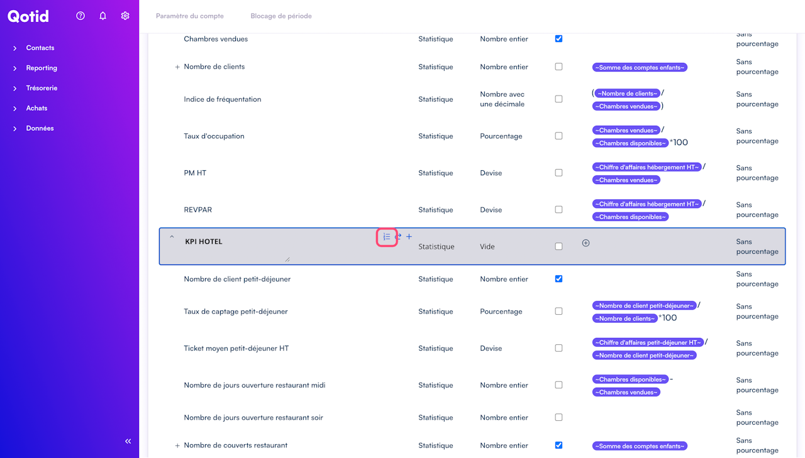
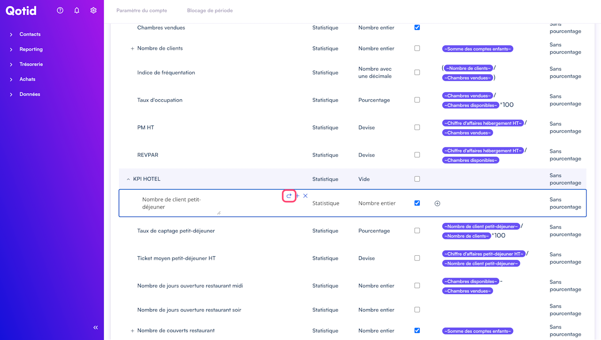
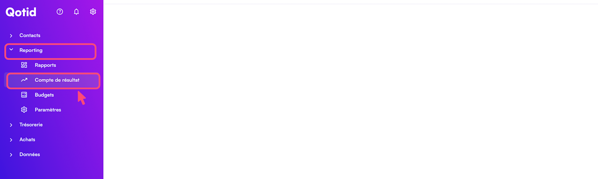

# Comment réorganiser les positions ou déplacer vos rubriques et sous-rubriques

## Modifier la position des rubriques parents

Lorsque votre modèle de reporting sera créé. Ce modèle sera appelé à chaque fois que vous créez une vue dans votre P\&L (Voir comment créer une nouvelle vue lors du choix de l'étape suivante) et le positionnement des rubriques et sous-rubriques de votre reporting sera basé sur votre modèle.

Si vous souhaitez modifier la position des premiers niveaux de parents de manière définitive dans l'ensemble de vos vues, il suffit de cliquer sur "**Réorganiser les comptes principaux**".

## Modifier la position des comptes enfants

En cliquant sur le bouton "**123**" vous pourrez réorganiser les rubriques enfants au sein de leur rubrique parent.

## Changer le parent d'une rubrique enfant

Vous pouvez si nécessaire déplacer des rubriques dans d'autres rubriques ou simplement positionner une rubrique enfant comme étant un parent selon vos besoins en cliquant sur "**Déplacer vers**".

## Comment créer une nouvelle vue de votre compte de résultat ?

Consultez également le guide [Comment créer une nouvelle vue de votre compte de résultat ?](https://support.qotid.com/kb/guide/fr/comment-creer-une-nouvelle-visualisation-sur-votre-compte-de-resultat-FzPLblsevc).
