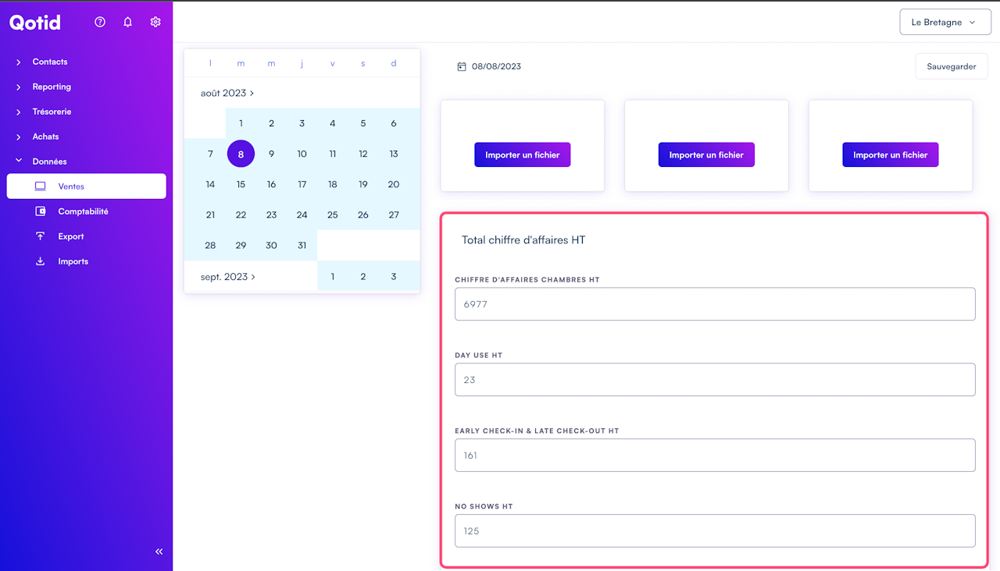
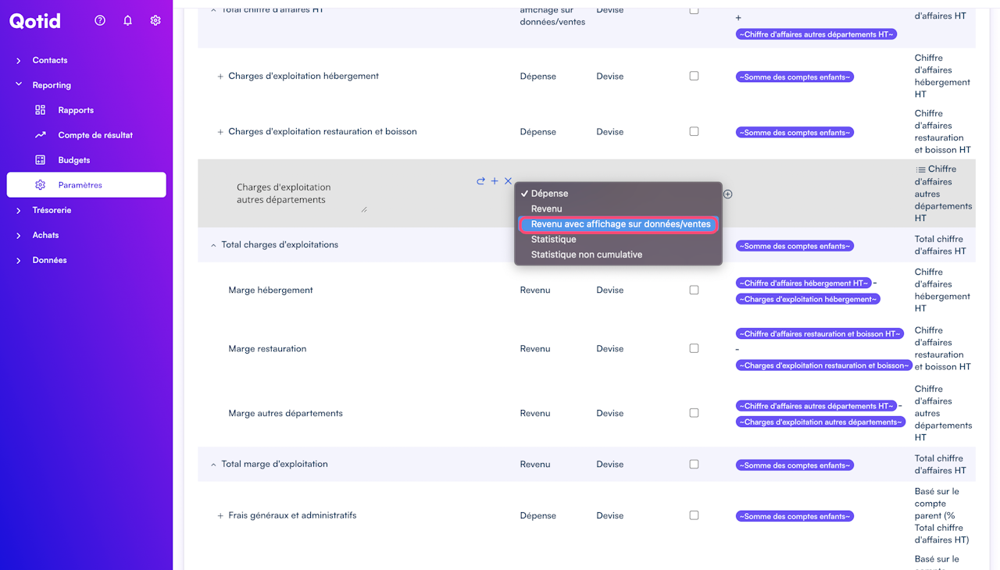
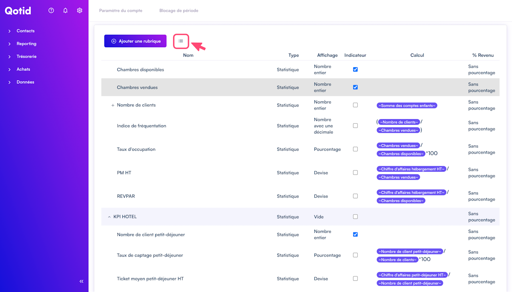
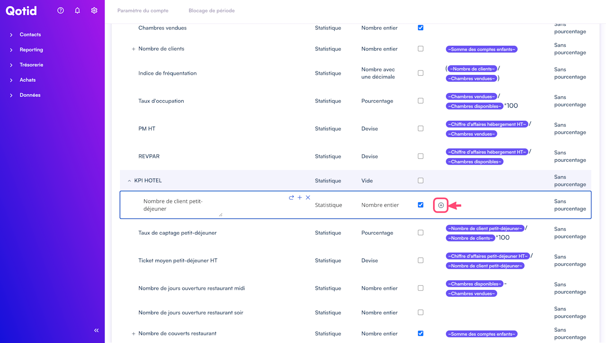
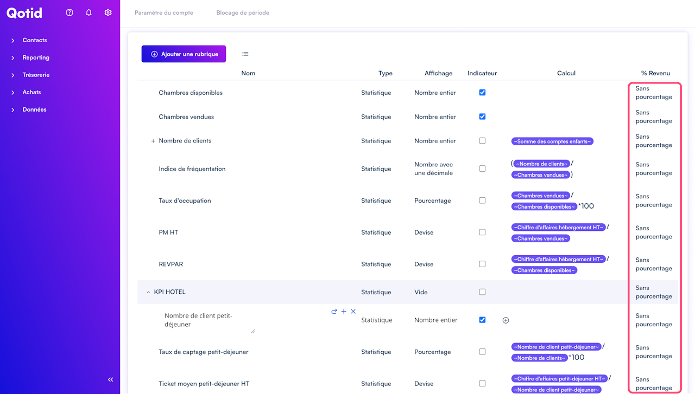
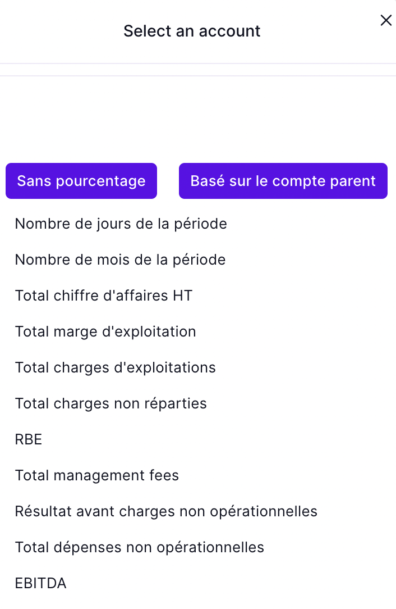

# Introduction au paramètre P\&L

## Accès aux paramètres P\&L

Le paramétrage de vos points de données sur votre P\&L est accessible uniquement pour les administrateurs.

Pour vous y rendre, cliquez sur "**Reportings**" à gauche de votre écran puis sélectionnez "**Paramètres**".

Grâce à cette fonctionnalité, vous pouvez configurer l'ensemble des points de données de votre modèle de reporting.

## Fin du guide

## 2. Comment ajouter de nouvelles rubriques dans votre P\&L

Consultez également le guide [2. Comment ajouter de nouvelles rubriques dans votre P\&L](comment-ajouter-de-nouvelles-rubriques-dans-votre-p-and-l.md).

## 3. Paramétrer vos rubriques selon le type et le mode d'affichage souhaités

Consultez également le guide [3. Paramétrer vos rubriques selon le type et le mode d'affichage souhaités](parametrer-vos-rubriques-selon-le-type-et-le-mode-daffichage-souhaites.md).

## 4. Comment réorganiser les positions ou déplacer vos rubriques et sous-rubriques

Consultez également le guide [4. Comment réorganiser les positions ou déplacer vos rubriques et sous-rubriques](comment-reorganiser-les-positions-ou-deplacer-vos-rubriques-et-sous-rubriques.md).

## 5. Ajouter des calculs spécifiques sur vos rubriques et sous-rubriques

Consultez également le guide [5. Ajouter des calculs spécifiques sur vos rubriques et sous-rubriques](ajouter-des-calculs-specifiques-sur-vos-rubriques-et-sous-rubriques.md).

## 6. Définir une rubrique comme étant un indicateur

Consultez également le guide [6. Définir une rubrique comme étant un indicateur](definir-une-rubrique-comme-etant-un-indicateur.md).

## 7. Définir l'affichage % Revenue

Consultez également le guide [7. Définir l'affichage % Revenue](comment-definir-laffichage-revenu.md).

## 8. Comment afficher vos points de données dans DONNEES / VENTES pour pouvoir saisir manuellement des informations ?

Consultez également le guide [8. Comment afficher vos points de données dans DONNEES / VENTES pour pouvoir saisir manuellement des informations ?](comment-afficher-vos-points-de-donnees-dans-donnees-ventes-pour-pouvoir-saisir-manuellement-des-in.md).
