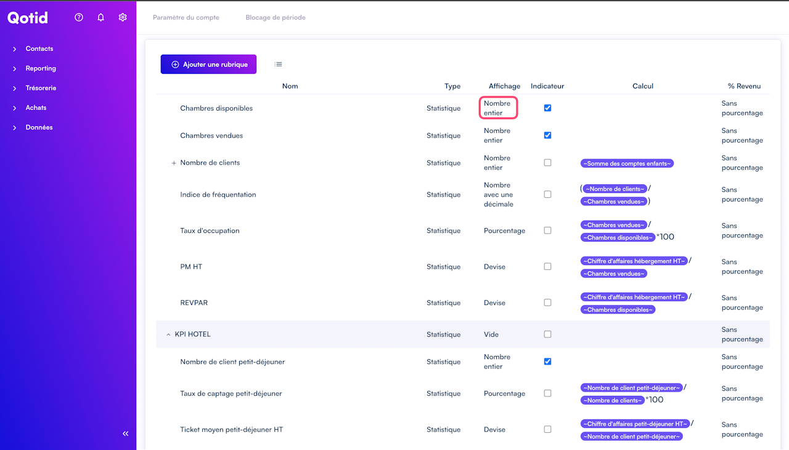

# Paramétrer vos rubriques selon le type et le mode d'affichage souhaités

## Paramétrer le type de votre rubrique

Il y a plusieurs types possibles. En voici la liste :

* **Revenue** : Lorsque une rubrique est considérée comme un revenu, lors de la création de vos tableaux de bords et notamment sur les variations entre N/N-1 par exemple, la variation sera de couleur verte lorsque le montant de l'année N est supérieur au montant de l'année N-1. En effet c'est un impact positif sur votre entreprise. Par exemple : Un chiffre d'affaires
* **Dépense** : Lorsque une rubrique est considérée comme une dépense, lors de la création de vos tableaux de bords et notamment sur les variations entre N/N-1 par exemple, la variation sera de couleur rouge lorsque le montant de l'année N est supérieur au montant de l'année N-1. En effet c'est un impact négatif sur votre entreprise. Par exemple : Frais de banque
* **Revenu :** avec affichage sur données/vente : C'est la même chose qu'un revenu à la différence près que le point de donnée sera visible sous DONNÉES / VENTE et que vous pourrez ainsi saisir manuellement des données ou visualiser les données insérer sur cette rubrique depuis cette interface. Par exemple : Un chiffre d'affaires
* **Statistiques** : C'est une donnée de type statistique. Cette donnée par défaut fonctionne comme un revenu à la différence que vous n'aurez jamais de données sur cette rubrique dans une colonne % de CA. Par exemple : Quantité, Prix Moyen, etc.
* **Statistiques non cumulatives** : C'est une donnée de type statistique à la différence que lorsque vous interrogerez ce point de donnée, la somme ne sera jamais cumulée. Par exemple : Avis client, Solde bancaire, etc. Cette donnée par défaut fonctionne comme un revenu à la différence que vous n'aurez jamais de données sur cette rubrique dans une colonne % de CA. Par exemple : Note Tripadvisor.

## Paramétrer l'affichage de votre rubrique

Il y a plusieurs types possibles. En voici la liste :

* **Nombre entier** : Affichage sans décimales. Par exemple : 1000.
* **Pourcentage** : Affichage avec le signe %. Par exemple : 100%.
* **Nombre avec une décimale** : Affichage avec une décimale. Par exemple : 1,2
* **Devise** : Affichage avec deux décimales et la devise. Par exemple : 20,00€.
* **Vide** : Affichage sans valeur, la case restera vide malgré que la rubrique contienne un calcul ou soit un parent (soit la somme de ces enfants).
