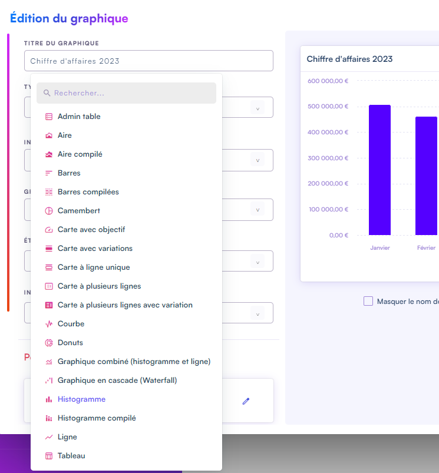
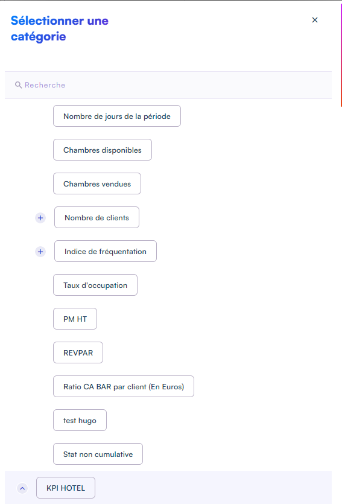

# 1. Présentation du module Tableaux de bord

## Présentation du module Tableaux de bord

Le module **Tableaux de bord** est un module de visualisation de vos données sous forme de graphiques ou de tableaux. Il vous permet d'analyser graphiquement l'ensemble des données créées lors de la personnalisation de votre compte de résultat. Sur cet espace, si votre administrateur vous en a donné les autorisations, vous pourrez créer autant de rapports et de graphiques que vous le souhaitez sans affecter l'espace des autres utilisateurs.

## Principe Général

Lors de la création de vos graphiques et tableaux, vous pouvez paramétrer les éléments suivants.

**Chemin : Type de graphique**

## Type de graphique

Il existe de nombreux types de graphiques pour présenter vos données : Courbe, histogramme, camembert, Aire, tableau...

**Chemin : Intervalle**

## Intervalle

Tout d'abord, le choix de l'intervalle dépend de la date sélectionnée (la date est située en haut à droite, à côté du nom de votre établissement). Vous pouvez choisir un intervalle sur les données que vous souhaitez afficher. Il existe plusieurs intervalles possibles : Hier, 7 derniers jours, 30 derniers jours, 3 derniers mois entiers, 6 derniers mois entiers, depuis le début de la semaine, etc.

**Chemin : Période**

## Période

Cet onglet permet de sélectionner la période que vous souhaitez afficher en fonction de la date sélectionnée (la date est située en haut à droite à côté du nom de votre établissement). Vous pouvez sélectionner : N, N-1, N-2,etc. Si le module budget est activé sur votre espace, vous pouvez sélectionner un de vos budgets sur l'année sélectionnée, afin de repasser sur des données réelles, il vous suffit de cliquer sur le budget afin de le désélectionner.

**Chemin : Groupé par**

## Groupé par

Cet onglet permet de définir l'axe d'analyse en abscisse. Vous avez la possibilité d'analyser vos données sous différentes formes :

* Par jour
* Par mois
* Par semaine (cela affichera les numéros de semaines en abscisse)
* Par jour de la semaine (du lundi au dimanche)
* Par établissement : permet d'afficher en abscisse plusieurs établissements. Pour cela, il faut créer un groupe consolidé et sélectionner le consolidé comme établissement par défaut sur le bouton en haut à droite de votre écran.

**Chemin : Donnée**

## Donnée

Cet onglet permet de sélectionner la donnée que vous souhaitez afficher sur le graphique. Cliquer sur une des rubriques vous affichera ses sous-rubriques, vous pourrez alors cliquer sur "**Sélectionner ce compte**" pour afficher la donnée correspondant a cette rubrique ou bien sélectionner une de ses sous-rubriques pour afficher la donnée correspondante a cette dernière.

**Chemin : Indicateur**

## Indicateur

Cet onglet permet d'afficher la donnée sélectionnée sous forme d'indicateur (KPI) sur votre graphique. Les indicateurs sont personnalisables et définis lors du paramétrage avec le client.

**Chemin : Titre du graphique**

## Titre du graphique

Ici vous pouvez nommer votre graphique.

**Chemin : Choix de l'établissement ou du groupe**

## Choix de l'établissement ou du groupe

Ici, vous pouvez choisir l'établissement ou le groupe consolidé que vous voulez analyser. Par défaut, l'établissement sera celui sur lequel vous êtes en haut à droite sur Qotid
