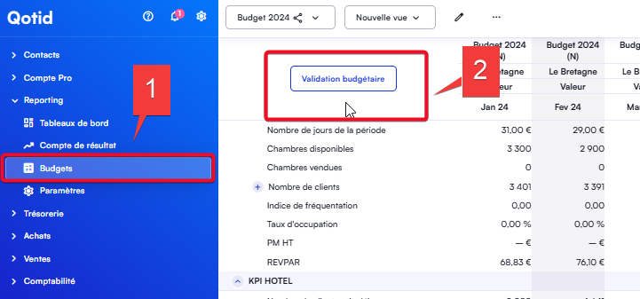
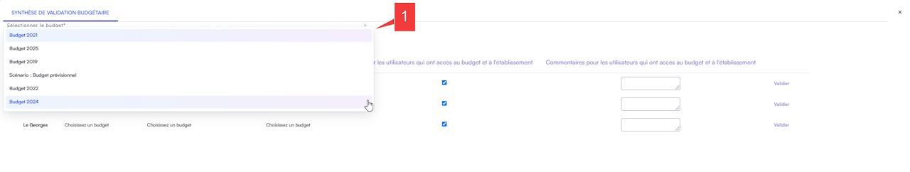
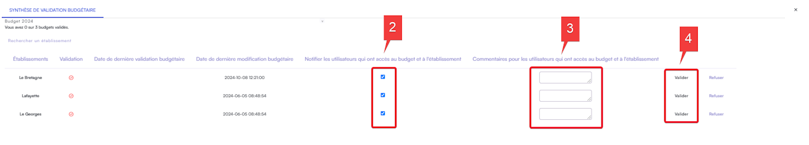
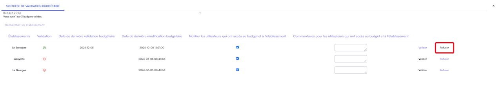

# Comment fonctionne la validation des budgets (Workflow des budgets)

## Introduction

Le workflow des budgets est un module de validation des données et de gestion de vos processus de validation en interne. Une fois vos budgets validés, vos collaborateurs ne pourront plus saisir ou modifier des données sur ceux-ci.

## Accès au workflow du budget

1. Cliquer sur l'onglet **"reporting"** puis sur **"budgets"**
2. Cliquer sur **"validation budgétaire"**

## Choix du budget et validation par établissement

1. Sélectionner le budget que vous voulez valider
2. Par défaut, tous les utilisateurs qui ont accès à ce budget et l'établissement seront notifiés par e-mail que le budget à été validé. Si vous ne voulez pas que les utilisateurs soient notifiés, vous pouvez décocher la case **"Notifier les utilisateurs qui ont accès au budget et à l'établissement"**
3. Vous pouvez écrire un commentaire qui sera incorporé au mail de validation du budget
4. Appuyer sur le bouton **"Valider"** pour valider votre budget

**Attention :**

Après validation du budget sur un établissement, il ne sera plus possible de modifier le budget sans le dévalider

## Dévalider un budget

Pour pouvoir saisir de nouveau sur un budget qui a été validé, vous devez obligatoirement le dévalider. Pour cela, il suffit d'appuyer sur le bouton "refuser" dans le workflow du budget
