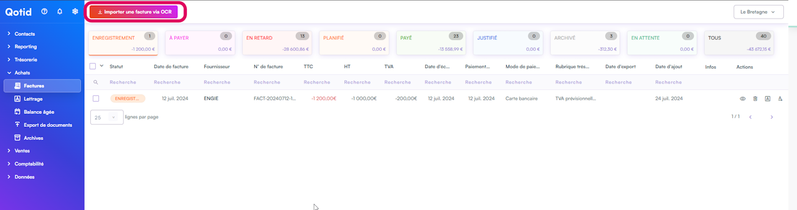

# \[DESKTOP] Comment déposer manuellement une facture ?

## Importer une facture

Cliquez sur le bouton "**Achat**" dans le menu principal à gauche de la page, puis cliquez sur "**Factures**".

La vue principale s'ouvrira vous permettant de sélectionner le fichier de votre facture en cliquant sur le bouton "**Importer une facture via OCR**" en haut à gauche.
