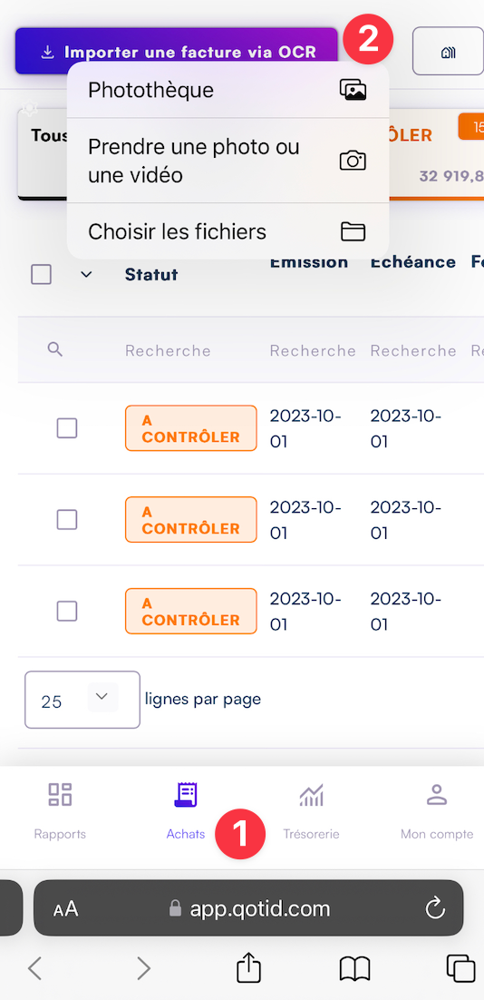

# \[MOBILE] Comment déposer manuellement une facture ?

## Importer une facture depuis le mobile

Cliquez sur le bouton "**Achat**" dans le menu principal.

Cliquez ensuite sur "**Importer une facture via OCR**" en haut à gauche.

Sélectionnez **Prendre une photo**.
