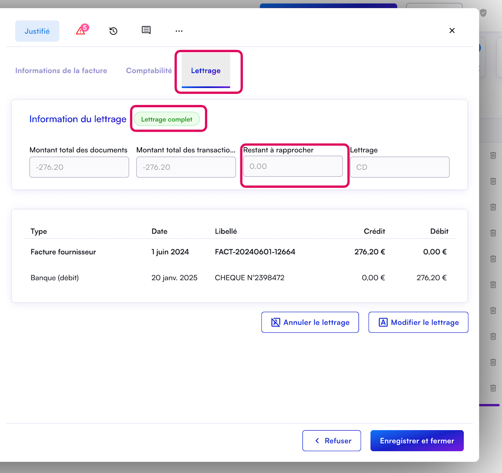
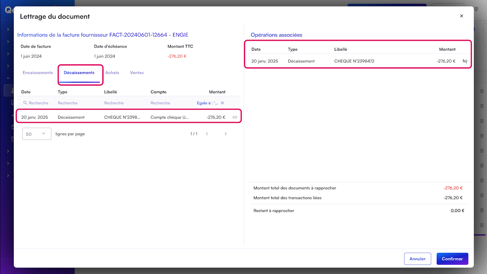

# Comment lettrer une transaction depuis une facture ?

## Accéder au lettrage de la facture

Cliquez sur le bouton "**Achat**" dans le menu principal à gauche de la page.

Ensuite, cliquez sur "**Factures**", puis sur le bouton en forme de **A** à droite.

## Autre méthode : depuis le détail de la facture

Cliquez directement sur la ligne de la facture pour accéder à la fenêtre affichant les détails. Cliquez ensuite sur les trois petits points "..." donnant accès aux autres actions, puis sur Lettrage.

## Lettrer la transaction

Une fois la fenêtre de lettrage ouverte, vous trouverez dans l'onglet **Décaissements** la transaction correspondant à la facture.

Qotid filtre automatiquement les montants "**Égal à...**". Cliquez ensuite sur la transaction à rapprocher, puis **Confirmez**.

## Voir le lettrage

Une fois le lettrage effectué, vous verrez un nouvel onglet **Lettrage** dans le détail de la facture. Vous pourrez le modifier ou l'annuler à tout moment. La facture apparaîtra dans l'onglet **Justifié**.

**À savoir :**

Si le restant à rapprocher est à 0,00 €, le lettrage apparaîtra comme **Complet**. S'il reste un solde résiduel, le lettrage apparaîtra comme **Partiel**.
