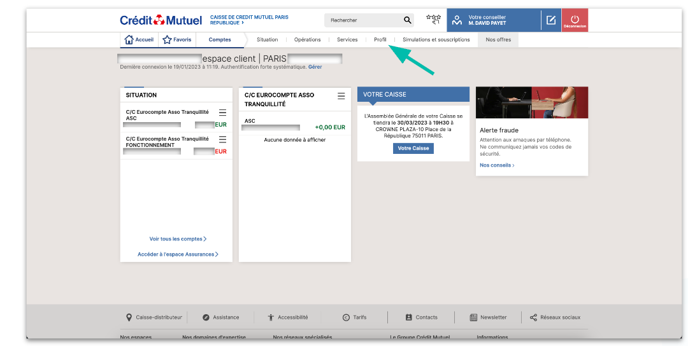
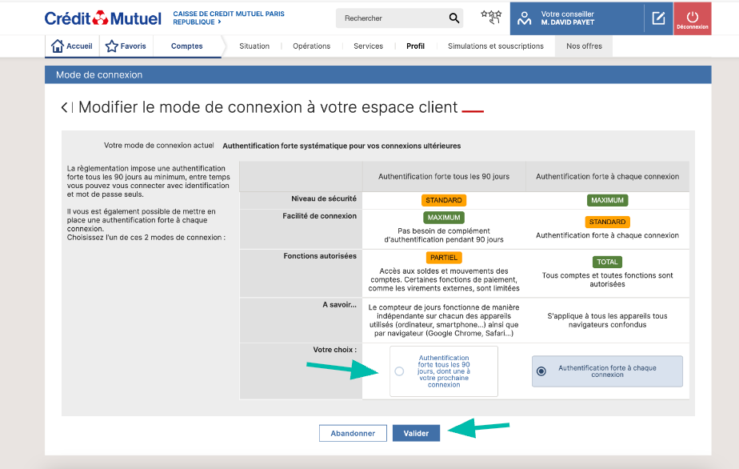

# CM/CIC - Paramétrer l'authentification forte à 90 jours pour éviter la reconnexion permanente sur QO

## Problème d'authentification permanente sur CM/CIC

Si votre banque est le CM / CIC, votre compte est probablement paramétré pour demander une authentification forte systématique. Pour éviter cela, demander une authentification forte moins fréquente et donc éviter de devoir vous reconnecter tous les jours sur Qotid, vous devez réaliser la manipulation suivante.

## Se connecter à l'interface bancaire

Connectez-vous à votre banque depuis votre ordinateur et cliquez sur "**Profil**".

## Accéder à la rubrique de gestion de l'authentification forte

Sous l'onglet Profil, cliquez sur "**Modes de connexion**".

## Modifier la durée d'authentification forte à 90 jours

Sélectionnez comme choix la première colonne correspondant à "**Authentification forte tous les 90 jours**".

Vous devez ensuite valider votre demande en indiquant le code de la carte multicodes.
