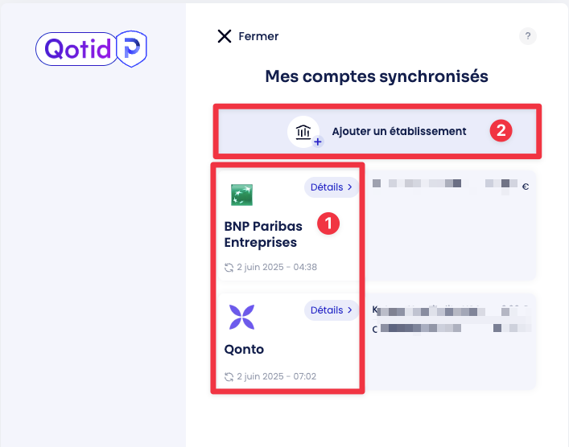
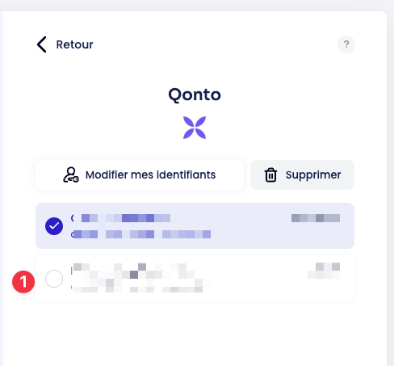
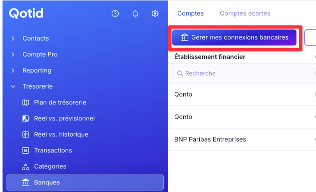
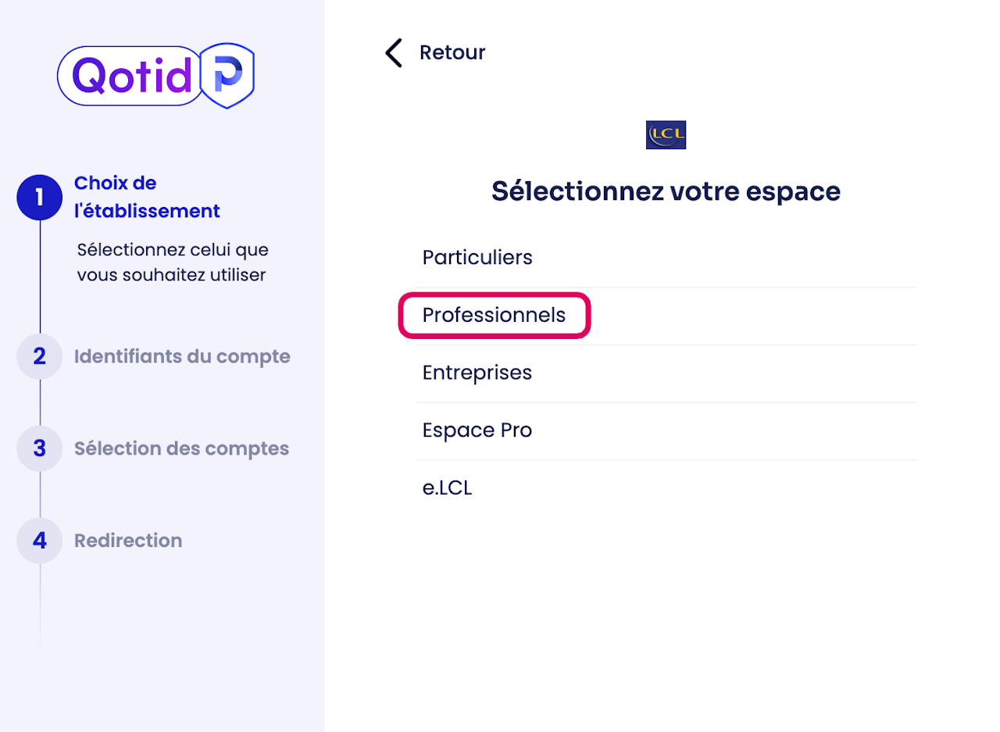
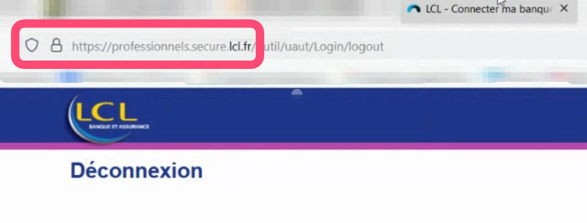

# Comment ajouter une nouvelle banque ou nouveau compte bancaire ?

## Connecter une nouvelle banque ou compte bancaire

Pour connecter votre nouvelle banque ou compte bancaire, vous devez d'abord cliquer sur votre module "**Trésorerie**" puis "**Banques**" cliquer sur "**Gérer mes connexions bancaires**".

## Connexion Powens

Vous serez alors redirigé vers une page dédiée à la connexion de votre banque.

Dans un premier temps, vous devez vérifier si :

1. **La banque est déjà connectée** : Le cas échéant il suffit de cliquer dessus et vous trouverez votre nouveau compte bancaire
2. La banque n'est pas déjà connectée : le cas échéant vous devrez cliquer sur **Ajouter un établissement**

**Attention :**

Si votre banque est déjà connectée, **il ne faut surtout pas connecter une deuxième fois votre banque.**

Si vous ne trouvez pas votre nouveau compte bancaire lorsque vous cliquez sur la banque connectée, veuillez contacter le support

## Ma banque est déjà connectée

Dans ce cas il suffit de cliquer sur la banque déjà connectée.

## Choisir le compte bancaire à ajouter

Puis de sélectionner dans la liste le compte bancaire à ajouter.

**Attention :**

Si votre nouveau compte bancaire n'apparait, **ne pas créer de nouvelles connexions via Ajouter un établissement**.

Le cas échéant, contacter le service support.

## Connecter le compte bancaire à votre établissement

Lorsque la connexion sera réussie, vous serez redirigé vers la page Qotid.

**À savoir :**

Si vous avez plusieurs établissements sur votre espace, vous devrez connecter votre compte bancaire à votre établissement.

Une fois cela réalisée, votre transaction et solde bancaire remonteront automatiquement sur Qotid (cela peut prendre 1-2 minutes).

## Echec de connexion

Si vous n'avez pas réussi à vous connecter ?

Il y a plusieurs possibilités ?

* Vous n'avez pas complété les bons identifiants pour vous connecter à votre banque
* Vous vous êtes trompés dans le choix de votre banque. Par exemple si vous êtes client LCL, il y a plusieurs choix possibles (LCL Pro, LCL Entreprises, LCL Espace Pro, etc).
* Le mode d'authentification n'a pas fonctionné. Par exemple si vous êtes clients BNP, il y a pour BNP Net Entreprises plusieurs types de connexion possible (Clé digitale, Navigation sécurisée, Lecteur). Parfois un mode de connexion peut échouer et il ne faut pas hésiter à essayer un autre.

Dans tous les cas, n'hésitez pas à recommencer une deuxième fois et si le problème persiste, contactez le service support qui pourra vous dépanner.

## Contacter le support

Consultez également le guide [Contacter le support](https://support.qotid.com/kb/fr/).

## J'ai réussi à connecter mon compte bancaire

Bravo !

Vous pouvez maintenant commencer à catégoriser vos flux de trésorerie, créer votre premier budget de trésorerie ou bien encore personnaliser vos rubriques.

## Comment catégoriser vos transactions bancaires

Consultez également le guide [Comment catégoriser vos transactions bancaires](https://support.qotid.com/kb/guide/fr/comment-visualiser-vos-transactions-bancaires-hTQm7xwuGj).

## Ma banque n'est pas déjà connectée

Dans ce cas il suffit de cliquer sur **Ajouter un nouvel établissement**

Ensuite il faudra sélectionner votre établissement dans la liste des établissements bancaires

## Choisir la bonne banque - Partie 1

Sur certaines banques. Par exemple le LCL vous serez amené à devoir choisir entre plusieurs banques (LCL Entreprise, LCL Espace Pro, etc).

## Choisir le bonne banque - Partie 2

Si vous n'êtes pas sûr et que vous souhaitez savoir précisément quelle banque choisir il est recommandé en parallèle de se connecter à votre banque via votre interface bancaire.

Lorsque vous serez connecter, visualiser l'url dans votre navigateur et faite le lien avec l'url présenter sur l'interface de connexion via Qotid.
