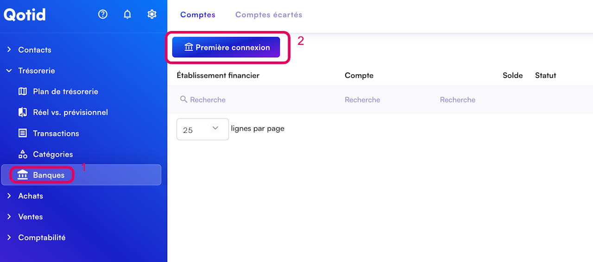
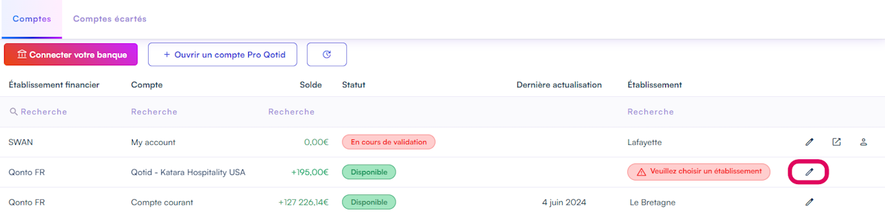
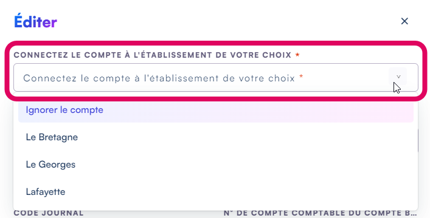

# Comment connecter votre banque ou compte bancaire ?

## Connecter votre banque ou compte bancaire

Pour connecter votre banque ou compte bancaire, vous devez d'abord cliquer sur votre module "**Trésorerie**", puis "**Banques**", puis cliquer sur "**Première connexion**" ou "**Gérer mes connexions bancaires**" (si vous avez déjà connecté une première banque).

## Connexion Powens

Vous serez alors redirigé vers une page dédiée à la connexion de votre banque.

Vous devrez utiliser la barre de recherche pour choisir votre banque et suivre pas à pas les instructions de connexion.

Pour information, Qotid ne stocke pas vos identifiants et mot de passe de connexion à votre banque.

## Choisir la bonne banque - Partie 1

Pour certaines banques, par exemple le LCL, vous serez amené à devoir choisir entre plusieurs banques (LCL Entreprise, LCL Espace Pro, etc.).

## Choisir la bonne banque - Partie 2

Si vous n'êtes pas sûr et que vous souhaitez savoir précisément quelle banque choisir, il est recommandé de vous connecter en parallèle à votre banque via votre interface bancaire.

Lorsque vous serez connecté, visualisez l'URL dans votre navigateur et faites le lien avec l'URL présentée sur l'interface de connexion via Qotid.

## Connecter le compte bancaire à votre établissement

Lorsque la connexion sera réussie, vous serez redirigé vers la page Qotid.

**À savoir :**

Si vous avez plusieurs établissements sur votre espace, vous devrez connecter votre compte bancaire à votre établissement.

Une fois cela réalisé, votre transaction et votre solde bancaire remonteront automatiquement sur Qotid (cela peut prendre 1 à 2 minutes).

## Échec de connexion

Si vous n'avez pas réussi à vous connecter, plusieurs causes sont possibles :

* Vous n'avez pas saisi les bons identifiants pour vous connecter à votre banque.
* Vous vous êtes trompé dans le choix de votre banque. Par exemple, si vous êtes client LCL, il y a plusieurs choix possibles (LCL Pro, LCL Entreprises, LCL Espace Pro, etc.).
* Le mode d'authentification n'a pas fonctionné. Par exemple, si vous êtes client BNP, il y a pour BNP Net Entreprises plusieurs types de connexion possibles (Clé digitale, Navigation sécurisée, Lecteur). Parfois, un mode de connexion peut échouer et il ne faut pas hésiter à en essayer un autre.

Dans tous les cas, n'hésitez pas à recommencer une deuxième fois et, si le problème persiste, contactez le service support qui pourra vous dépanner.

## Contacter le support

Consultez également le guide [Contacter le support](https://support.qotid.com/kb/fr/).

## J'ai réussi à connecter mon compte bancaire

Bravo !

Vous pouvez maintenant commencer à catégoriser vos flux de trésorerie, créer votre premier budget de trésorerie ou bien encore personnaliser vos rubriques.

## Comment catégoriser vos transactions bancaires

Consultez également le guide [Comment catégoriser vos transactions bancaires](../transactions-bancaires/comment-categoriser-vos-transactions-bancaires.md).

## Comment créer vos rubriques d'encaissement et décaissement

Consultez également le guide [Comment créer vos rubriques d'encaissement et décaissement](../parametrage-du-tableau-de-tresorerie/comment-creer-vos-rubriques-dencaissement-et-decaissement.md).

## Comment saisir votre budget de trésorerie

