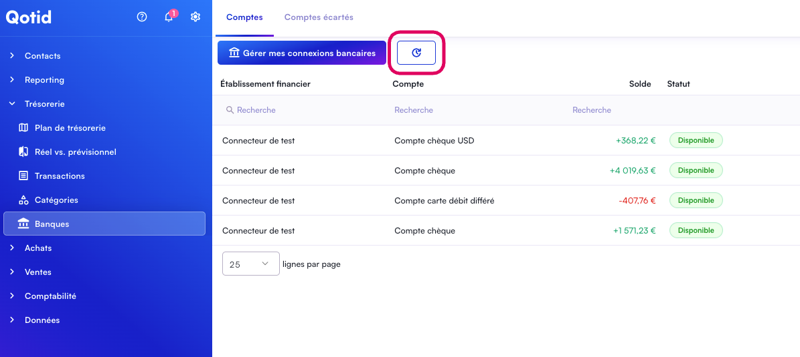

# Comment se fait l’actualisation de mes transactions bancaires et puis-je le faire manuellement ?

## Actualisation de mes transactions bancaires

Une fois votre banque connectée, nous actualisons de manière automatique vos transactions bancaires plusieurs fois par jour.

Toutefois, vous pouvez lancer l'actualisation manuellement à tout moment. Pour cela, il suffit de vous rendre sur l'onglet Trésorerie / Banques, puis de cliquer sur l'icône Horloge pour récupérer les dernières transactions.
