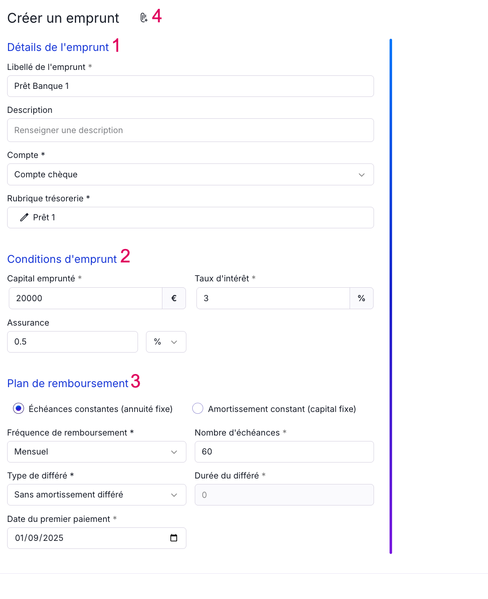
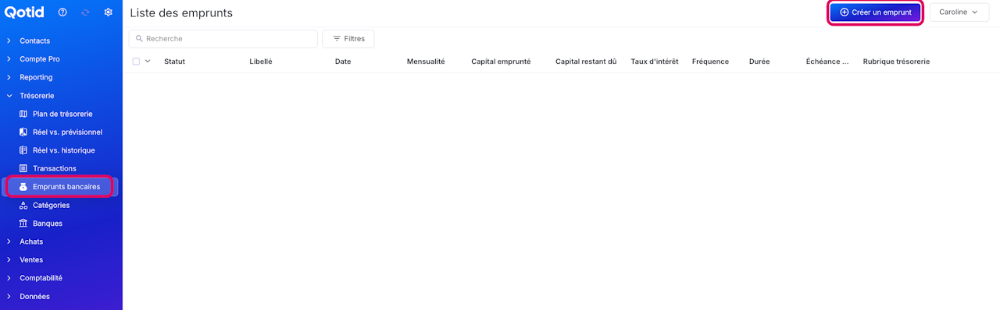
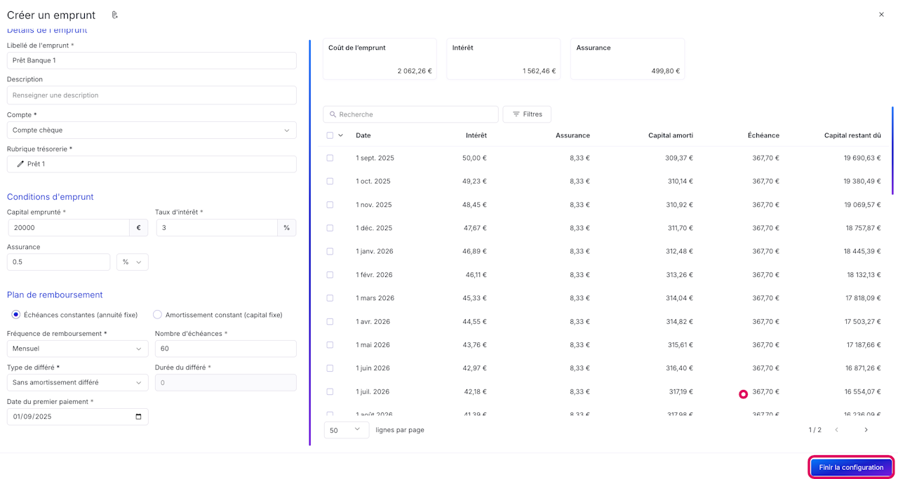
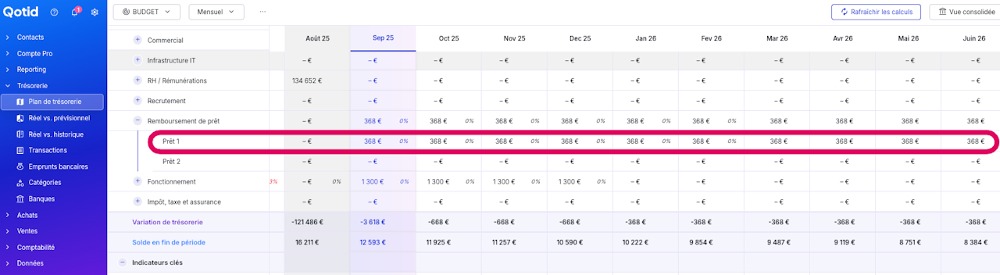
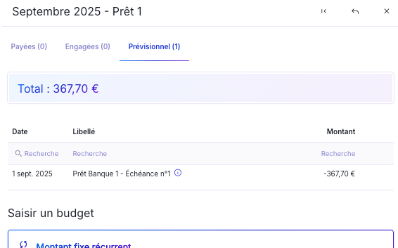

# Comment créer un échéancier de remboursement d'emprunt ?

## Emprunts bancaires

Pour alimenter votre prévisionnel de trésorerie avec un échéancier de remboursement de votre emprunt bancaire, vous pouvez vous rendre dans l'onglet Trésorerie / Emprunts bancaires, puis cliquer sur le bouton "**Créer un emprunt**".

## Créer un emprunt

Vous pouvez ensuite renseigner les informations liées à votre emprunt :

1 - Détail de l'emprunt (libellé, compte bancaire, rubrique de trésorerie associée)

2 - Conditions de l'emprunt (capital emprunté, taux, assurance)

3 - Plan de remboursement (échéance, fréquence, date du 1er remboursement)

4 - Vous pouvez également ajouter en pièce jointe le justificatif bancaire lié à l'emprunt.

## Générer l'échéancier

Une fois le paramétrage terminé, vous pouvez cliquer sur le bouton "**Générer l'échéancier**".

## Finir la configuration

Votre échéancier est maintenant prêt : vous pouvez cliquer sur le bouton "**Finir la configuration**".

## Visualiser ses échéances dans le prévisionnel de trésorerie

Une fois votre emprunt créé, vous pouvez vous rendre dans l'onglet Trésorerie / Plan de trésorerie.

Vous pourrez visualiser votre emprunt sur la rubrique de trésorerie que vous aviez sélectionnée (dans notre exemple, il s'agit de la rubrique Prêt 1).
