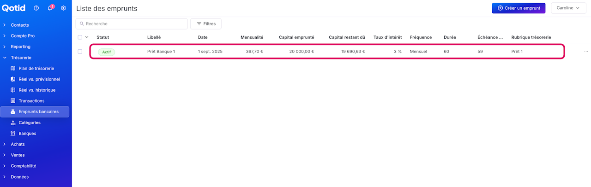
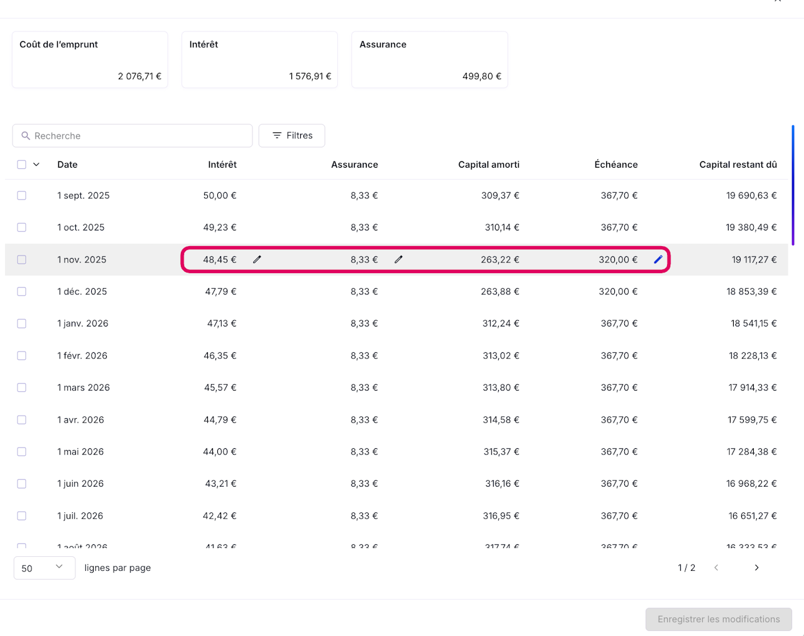

# Comment modifier mon emprunt bancaire ?

## Emprunts bancaires

Une fois que vous avez créé votre échéancier d'emprunt bancaire, vous pouvez le modifier à tout moment.

Pour cela, vous pouvez vous rendre sur l'onglet Trésorerie/Emprunts bancaires.

Cet onglet contient la liste de tous les emprunts bancaires que vous avez créé.

Il suffit ensuite de cliquer sur l'emprunt que vous souhaitez modifier.

## Modifier les échéances

Vous pouvez modifier les échéances en cliquant sur le stylo à côté de chacune d'elles.

Il faut cependant faire attention à ce que le solde du capital restant dû de la dernière ligne soit bien égal à 0 sinon vous ne pourrez pas sauvegarder vos modifications.
