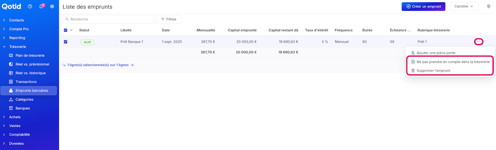

# Comment supprimer mon emprunt bancaire dans le prévisionnel de trésorerie ?

## Supprimer son emprunt bancaire

Il faut se rendre dans l'onglet Trésorerie / Emprunts bancaires.

Sélectionnez l'emprunt concerné et cliquez sur les "..." à droite de la ligne.

Vous avez alors deux possibilités :

1 - Supprimer l'emprunt complètement.

2 - Ne pas le prendre en compte dans la trésorerie : celui-ci sera toujours visible dans l'onglet Trésorerie / Emprunts bancaires, mais ne sera plus visible dans le prévisionnel de trésorerie.
