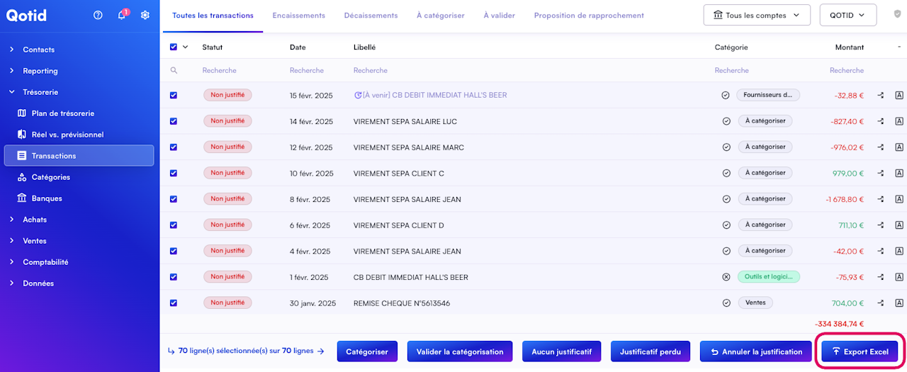

# Comment exporter vos transactions bancaires ?

## Export des transactions

Pour exporter vos transactions bancaires au format Excel, vous pouvez vous rendre dans le module Trésorerie, onglet Transactions.

Sélectionnez ensuite les transactions que vous souhaitez exporter et cliquez sur le bouton **Export Excel**.
