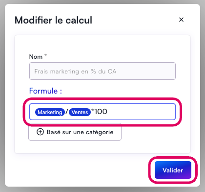

# Comment créer un indicateur sur mon plan de trésorerie ?

## Créer un indicateur

Pour créer un indicateur personnalisé sur votre plan de trésorerie, vous pouvez vous rendre dans le module Trésorerie / Catégories, puis sélectionner l'onglet Indicateurs clés.

Cliquez ensuite sur le bouton "**Ajouter une rubrique**".

## Paramétrage de l'indicateur

Dans cet exemple, nous allons créer un indicateur permettant d'avoir la part des frais marketing en % du chiffre d'affaires.

1. Renommez votre indicateur
2. Sélectionnez le mode d'affichage de l'indicateur (en devise, en pourcentage, nombre entier, etc.)
3. Cliquez sur la calculatrice pour définir le calcul lié à votre indicateur

## Paramétrage du calcul

Une fenêtre s'ouvre, permettant de modifier le calcul de l'indicateur.

Cliquez sur le bouton **Basé sur une catégorie** pour sélectionner les catégories sur lesquelles sera basé votre indicateur.

## Valider le calcul

Une fois votre calcul défini, cliquez sur le bouton **Valider**.

## Visualiser votre indicateur

Pour visualiser votre indicateur, vous pouvez vous rendre dans l'onglet Trésorerie / Plan de trésorerie.

Vous retrouverez votre indicateur en bas du tableau de trésorerie.
