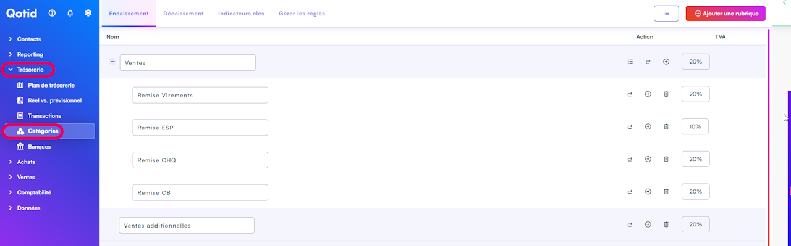
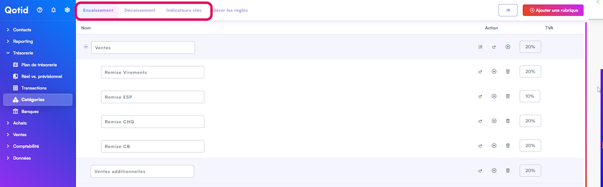
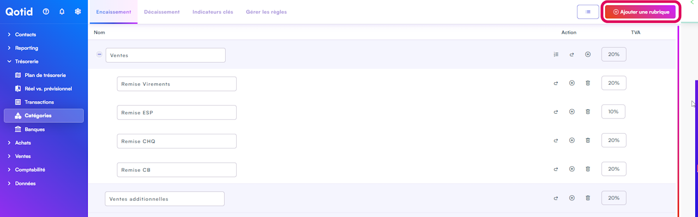
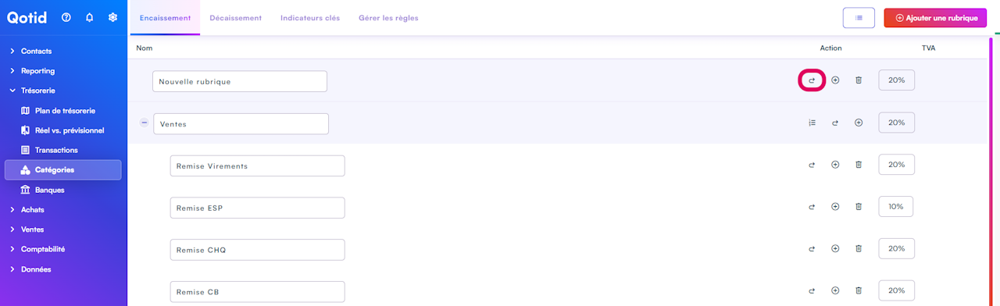
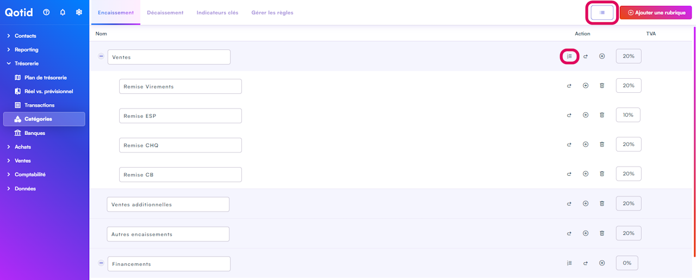
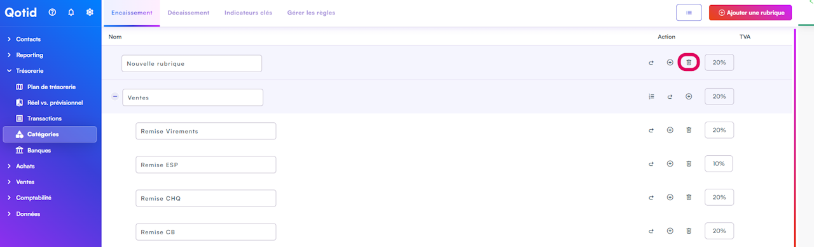
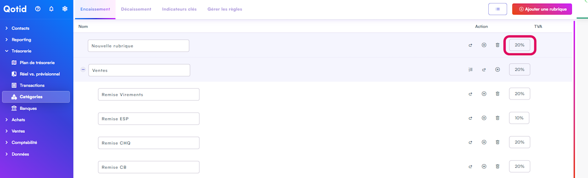
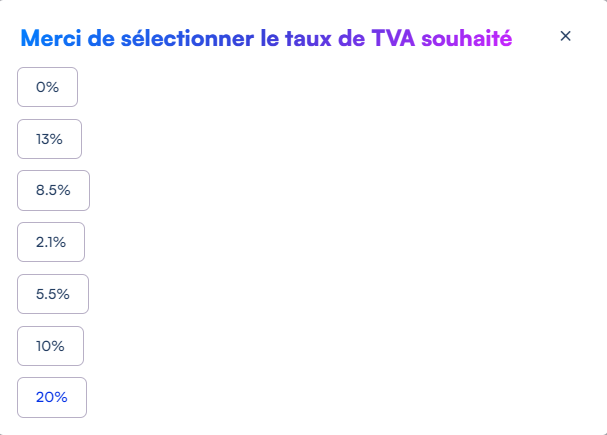

# Comment créer vos rubriques d'encaissement et décaissement

## Créer vos rubriques d'encaissement et décaissement

Pour créer vos rubriques d'encaissement et de décaissement de manière personnaliser il faut vous rendre sur "**Trésorerie**" puis "**Catégories**".

## Choisir la catégorie

À partir de cette page vous pouvez sélectionner les catégories d'encaissement ou de décaissement ou d'indicateurs clés.

## Créer une rubrique parent

Lorsque vous arrivez dans la catégorie de votre choix (encaissement, décaissement ou statistique) vous pouvez créer une nouvelle rubrique Parent en cliquant sur "**Ajouter une rubrique**".

Cette rubrique sera automatiquement ajoutée en haut et nommée "**Nouvelle rubrique**".

Vous pourrez ensuite renommer cette rubrique en cliquant dessus.

## Créer une rubrique enfant

Pour créer une rubrique Enfant sur une rubrique déjà existante, il suffit de cliquer sur la rubrique en question et de cliquer sur le "**+**".

Cette rubrique Enfant sera nommée par défaut "**Nouvelle rubrique**". Pour la renommée, cliqué sur la rubrique.

## Déplacer une rubrique

Vous pouvez également déplacer une rubrique existante dans une autre rubrique.

## Réorganiser les rubriques

Vous pouvez également réorganiser une rubrique Enfant ou les rubriques Parents en cliquant sur le symbole entouré en rouge.

## Supprimer une rubrique

Pour supprimer une rubrique, il suffit de cliquer sur le bouton de suppression.

**Attention :**

Attention vous ne pourrez supprimer une rubrique Parent contenant des Enfants. Pour cela vous devrez d'abord déplacer les Enfants dans une autre catégorie ou les supprimer avant de pouvoir supprimer le Parent.

## Choisir la TVA

Pour finir vous devrez définir un montant de TVA pour la catégorie que vous venez de créer. Pour se faire, cliquez sur la valeur de TVA et sélectionnez le bon montant.

**Attention :**

Le code TVA choisie est important puisqu'il permet à Qotid d'estimer les montants de TVA que vous serez amené à décaisser ou encaisser.

**À savoir :**

Le code de TVA sur la rubrique Parent permet simplement d'affecter par défaut ce code TVA sur les nouvelles rubriques Enfants qui seront créées.
