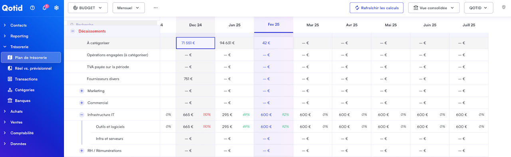
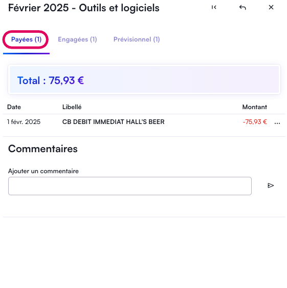
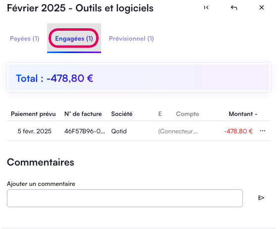
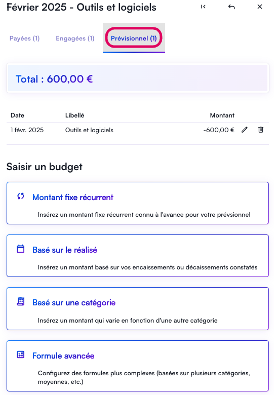

# Comment appréhender les montants que je vois sur mon plan de trésorerie ?

## Plan de trésorerie

Le plan de trésorerie est alimenté par 3 sources de données :

* Les transactions bancaires ("payées")
* Les factures d'achat et de ventes importées sur Qotid ("engagées")
* Le prévisionnel de trésorerie saisi sur Qotid ("prévisionnel")

Il est important de comprendre d'où vient le montant que je vois car c'est celui-ci qui est pris en compte dans le calcul de mon solde de trésorerie prévisionnel :

* Sur les mois passés : le montant correspond à la somme des transactions bancaires ("payées")
* Sur les mois à venir : on affiche d'abord le prévisionnel. Dès lors que le montant des engagées **est supérieur au prévisionnel,** on affiche alors ce montant.
* Sur le mois en cours : on affiche d'abord le prévisionnel. Dès lors que l'addition des factures réalisées + engagées **est supérieur au prévisionnel,** on affiche alors cette somme.

Je peux à tout moment, cliquer sur un montant pour comprendre d'où il vient et voir le détail de mes trois sources de données (payé / engagé / prévisionnel).

Sur notre exemple, on peut cliquer sur la donnée de Février 2025 (rubrique "Outils et logiciels") pour avoir le détail du montant affiché : **600€.**

**Attention :**

Cette logique de calcul permet de toujours être au plus proche de la réalité lorsqu'on calcule votre solde prévisionnel de trésorerie.

## Onglet Payées

Une fenêtre s'ouvre et détaille par onglet les données.

Dans l'onglet **Payées**, on retrouve toutes les transactions bancaires que l'on a catégorisées dans "Outils et logiciels" sur le mois de février 2025.

## Onglet Engagées

Dans l'onglet **Engagées**, on retrouve toutes les factures **non payées** que l'on a catégorisées dans "Outils et logiciels" et dont la date de paiement est prévue sur le mois de Février 2025.

## Onglet Prévisionnel

Dans l'onglet **Prévisionnel**, on retrouve le prévisionnel de trésorerie que l'on a défini au préalable pour la catégorie "Outils et logiciels" sur le mois de février 2025

**Attention :**

Dans notre exemple, le montant finalement affiché sur la catégorie du mois en cours est donc celui du prévisionnel (600€). En effet, pour le moment, la somme des factures engagées et payées (478.80€ + 75.93€) est inférieur à mon prévisionnel total.

## Comment appréhender la TVA prévisionnelle indiquée sur le tableau de trésorerie ?

Consultez également le guide [Comment appréhender la TVA prévisionnelle indiquée sur le tableau de trésorerie ?](comment-apprehender-la-tva-previsionnelle-indiquee-sur-le-tableau-de-tresorerie.md).
