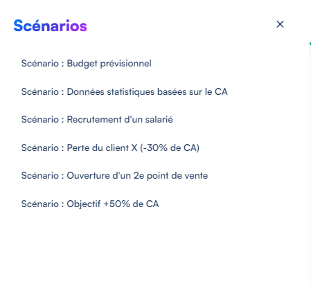
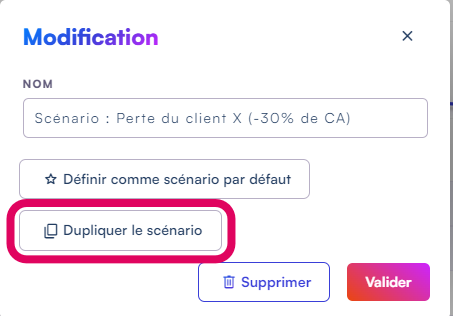

# Comment dupliquer un budget de trésorerie

## Dupliquer un budget de trésorerie

Pour dupliquer un budget de trésorerie, rendez-vous sur "**Trésorerie**", puis "**Plan de trésorerie**", cliquez sur votre budget, puis sur "**Paramètres des scénarios**".

## Dupliquer

Sélectionnez le budget que vous souhaitez dupliquer et cliquez sur "**Dupliquer**".
