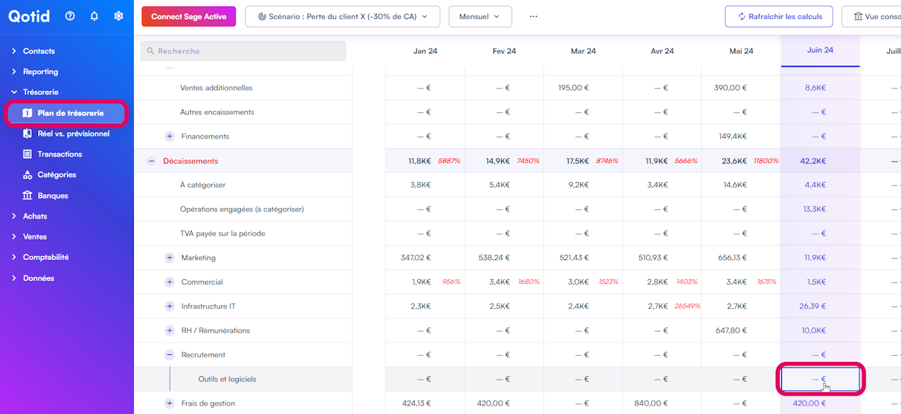
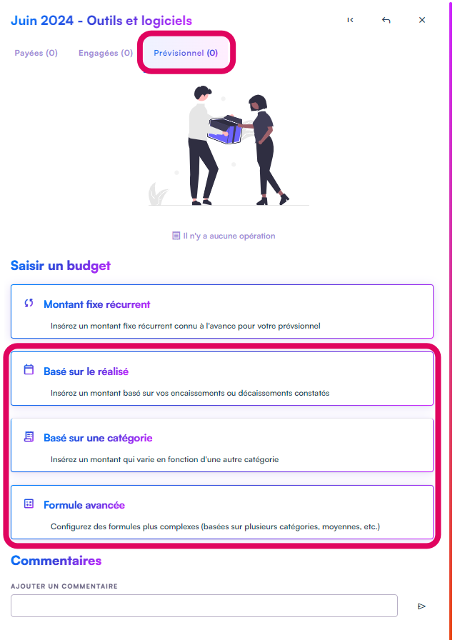
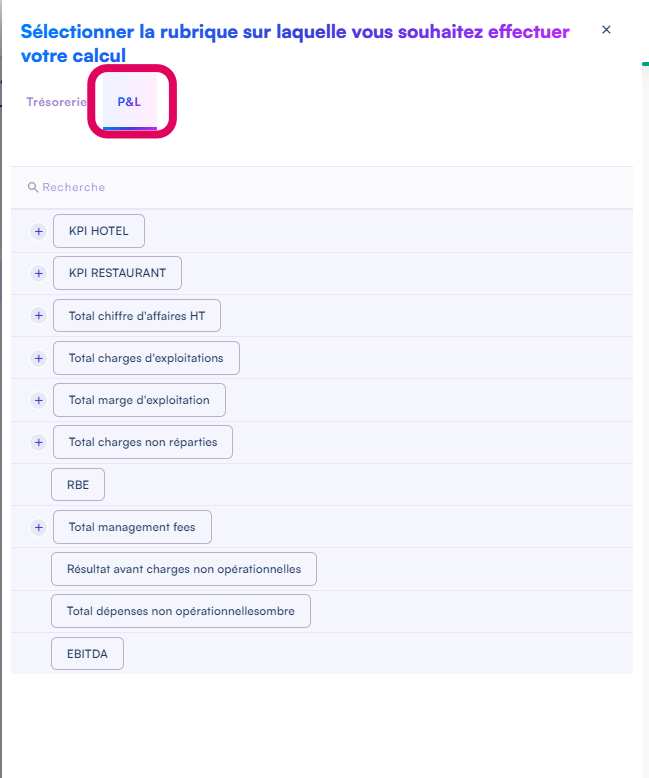
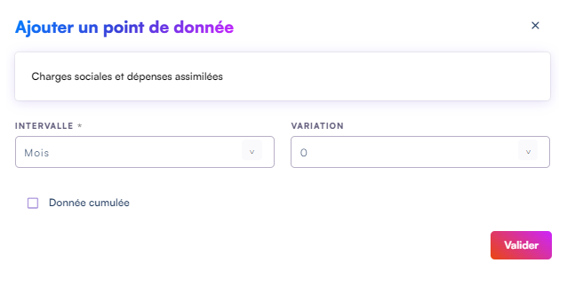
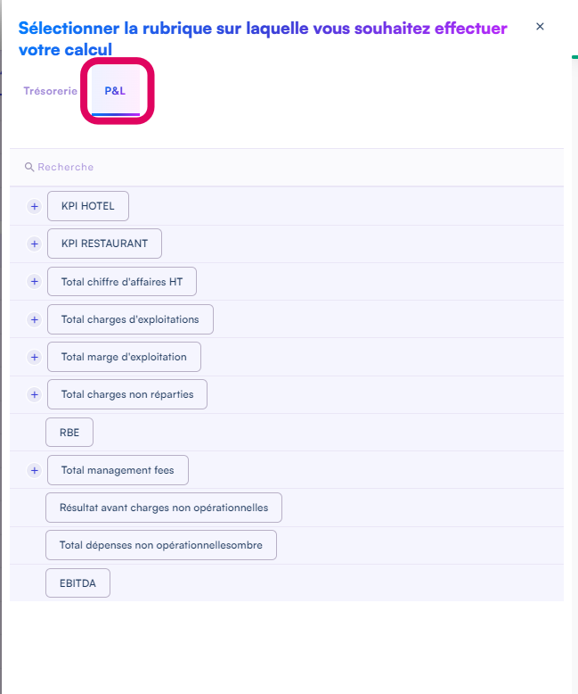
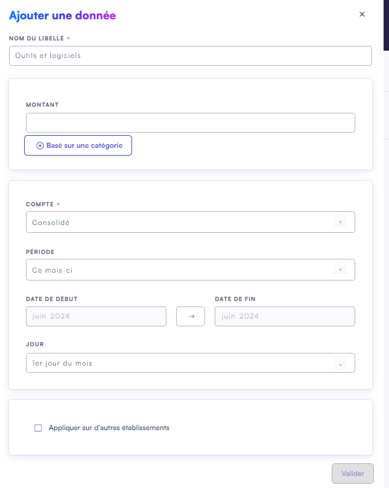

# Comment saisir une donnée budgétaire à partir d'une rubrique de mon P\&L ?

## Accéder au plan de trésorerie

Dans le menu principal à gauche de la page, cliquez sur "**Trésorerie**" puis "**Plan de trésorerie**".

Cliquez sur le montant de la donnée budgétaire que vous souhaitez ajouter.

**À savoir :**

Le module BI / Reporting doit être activé pour y accéder.

## Ajouter une donnée budgétaire

Une nouvelle fenêtre s'ouvrira, cliquez sur "**Prévisionnel**". Vous aurez la possibilité de saisir une donnée à partir d'une rubrique de votre P\&L depuis trois fonctions différentes :

* Un montant basé sur le réalisé
* Un montant basé sur une catégorie
* Un montant basé sur une formule

## A partir d'un montant basé sur le réalisé

Une fois la création de budget à partir d'un montant basé sur le réalisé sélectionné, une fenêtre apparaîtra.

Choisissez P\&L en haut à gauche. Puis choisissez le réalisé sur lequel le montant sera basé en faisant défiler la liste ou bien en cherchant dans la barre de recherche.

## A partir d'un montant basé sur le réalisé 2

La fenêtre qui s'ouvre permet de choisir parmi les cases :

* **Intervalle** : vous avez le choix entre garder uniquement la période choisi, ou bien cumuler les périodes à l'aide du bouton "**Donnée cumulé**".
*   **Variation** : Vous permet de sélectionner la période du réel à reporter

    Cliquez sur "**Valider**" pour sauvegarder votre choix.

## A partir d'un montant basé sur une catégorie

Une fois la création du budget à partir d'un montant basé sur une catégorie choisi, une fenêtre s'ouvrira.

Choisissez P\&L en haut à gauche. Puis choisissez la catégorie sur laquelle le montant sera basé en faisant défiler la liste ou bien en cherchant dans la barre de recherche.

## A partir d'un montant basé sur une catégorie

La fenêtre qui s'ouvre permet de choisir parmi les cases :

* **Intervalle** : vous avez le choix entre garder uniquement la période choisi, ou bien cumuler les périodes à l'aide du bouton "**Donnée cumulé**".
*   **Variation** : Vous permet de sélectionner la période du réel à reporter

    Cliquez sur "**Valider**" pour sauvegarder votre choix.

## A partir d'un montant basé sur une formule

Une fois la création du budget à partir d'un montant basé sur une formule choisi, une fenêtre s'ouvrira.

Saisissez la formule sur laquelle le montant sera basé puis choisissez les champs qui suivent.

Une fois paramétré, cliquez sur "**Valider**".
