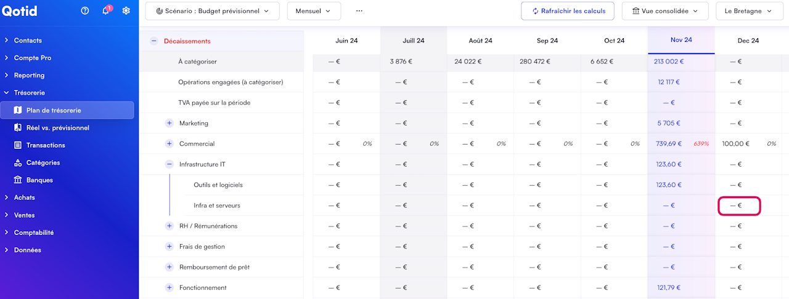
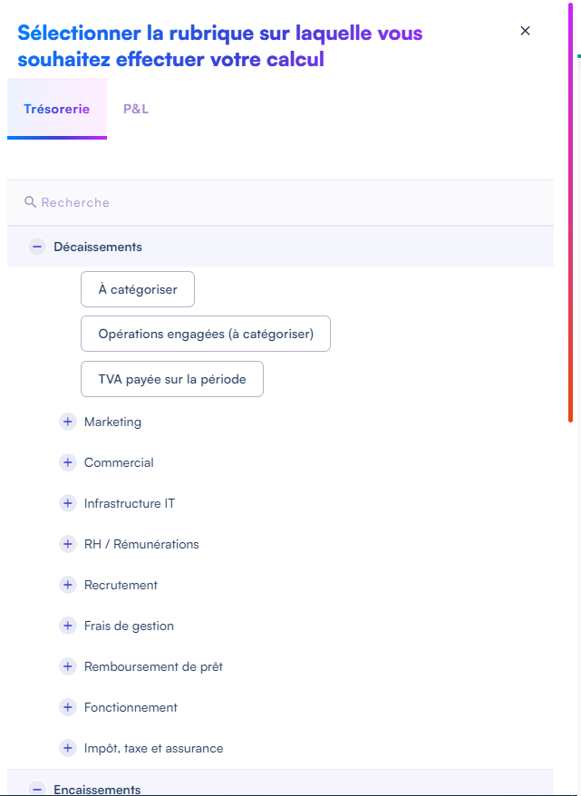

# Comment saisir une donnée budgetaire?

## Accéder au plan de trésorerie

Dans le menu principal à gauche de la page, cliquez sur "**Trésorerie**" puis "**Plan de trésorerie**".

Cliquez sur la donnée budgétaire que vous souhaitez ajouter. _(Exemple en screen : Infra et serveurs sur le mois de décembre)_

## Ajouter une donnée budgétaire

Une nouvelle fenêtre s'ouvrira. Vous aurez la possibilité de créer votre budget à partir de quatre fonctions différentes :

* Un montant fixe récurrent
* Un montant basé sur le réalisé
* Un montant basé sur une catégorie
* Un montant basé sur une formule

## Budget à partir d'un montant fixe récurrent

Une fois la création du budget à partir d'un montant fixe récurrent sélectionné, une fenêtre s'ouvrira.

Remplissez le montant fixe récurrent, puis sélectionnez le compte bancaire où le budget sera créé, choisissez la période ainsi que la récurrence s'il y en a une. Vous avez aussi la possibilité d'ajouter ce budget à d'autres établissements en cochant la case et en sélectionnant les autres établissements.

Pour finaliser, cliquez sur le bouton "**Valider**".

## Budget à partir d'un montant basé sur le réalisé

Une fois la création de budget à partir d'un montant basé sur le réalisé sélectionné, une fenêtre apparaîtra.

Choisissez le réalisé sur lequel le montant sera basé en faisant défiler la liste ou bien en cherchant dans la barre de recherche.

## Budget à partir d'un montant basé sur le réalisé (2)

La fenêtre qui s'ouvre permet de choisir parmi les cases :

* **Intervalle** : vous avez le choix entre garder uniquement la période choisi, ou bien cumuler les périodes à l'aide du bouton "**Donnée cumulé**".
*   **Variation** : Vous permet de sélectionner la période du réel à reporter

    Cliquez sur "**Valider**" pour sauvegarder votre choix.

## Budget à partir d'un montant basé sur une catégorie

Une fois la création du budget à partir d'un montant basé sur une catégorie choisi, une fenêtre s'ouvrira.

Choisissez la catégorie sur laquelle le montant sera basé en faisant défiler la liste ou bien en cherchant dans la barre de recherche.

## Budget à partir d'un montant basé sur une catégorie (2)

La fenêtre qui s'ouvre permet de choisir parmi les cases :

* **Type de données** : les données réelles où budget
* **Intervalle** : vous avez le choix entre garder uniquement la période choisi, ou bien cumuler les périodes à l'aide du bouton "**Donnée cumulé**".
*   **Variation** : Vous permet de sélectionner la période du réel à reporter

    Cliquez sur "**Valider**" pour sauvegarder votre choix.

## Budget à partir d'un montant basé sur une formule

Une fois la création du budget à partir d'un montant basé sur une formule choisi, une fenêtre s'ouvrira.

Saisissez la formule sur laquelle le montant sera basé puis choisissez les champs qui suivent.

Une fois paramétré, cliquez sur "**Valider**".
