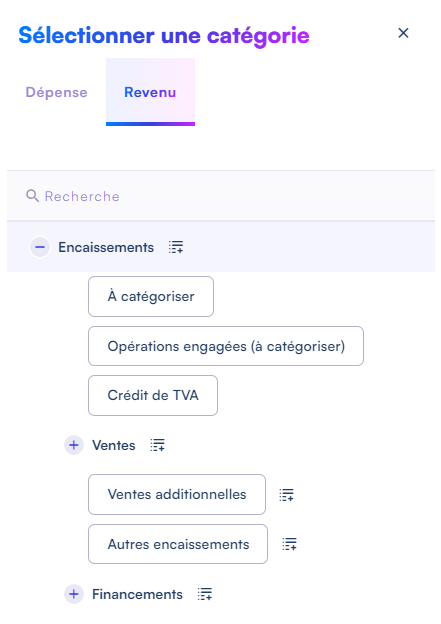
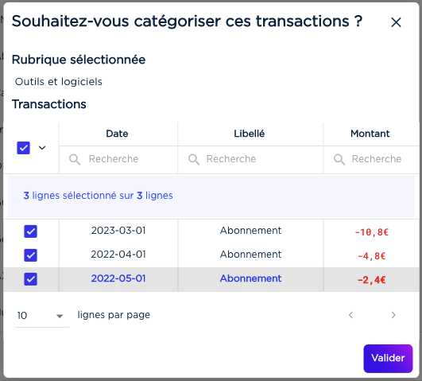
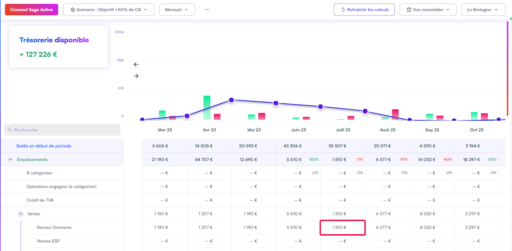

# Comment catégoriser vos transactions bancaires ?

## Catégoriser vos flux bancaires

Pour catégoriser vos flux bancaires, il existe trois possibilités :

## Catégoriser depuis la page transaction

Pour catégoriser vos flux de transaction depuis la page **Transactions**, il suffit de cliquer sur la transaction à catégoriser.

**À savoir :**

Par défaut, toutes les transactions sont indiquées comme **à catégoriser.** Lorsque vous aurez catégorisé pour la première fois votre transaction Qotid retiendra vos choix et la prochaine transaction sera automatiquement catégorisée.

## Choisir la catégorie

Une fois que vous avez cliqué pour modifier la transaction que vous souhaitez catégoriser, un pop-up s'ouvrira et vous pourrez choisir si le flux est une dépense ou un revenu et sélectionner la rubrique où vous souhaitez affecter la transaction.

**À savoir :**

N'hésitez pas à utiliser la fonction de recherche pour trouver plus facilement la rubrique de votre choix.

## Valider votre choix

Lorsque vous catégorisez une transaction, Qotid reconnaît automatiquement les transactions identiques qui n'ont pas été catégorisées. Si c'est le cas, il vous demandera si vous souhaitez réaliser la même catégorisation pour ces transactions.

Une fois votre choix valider vous retrouverez vos transactions dans votre plan de trésorerie

## Depuis la page Plan de trésorerie

Depuis votre **Plan de trésorerie**, vous trouverez l'ensemble des transactions déjà catégorisées.

Pour cela il suffit de cliquer sur la rubrique du mois actuel que vous souhaitez visualiser.

## Pop-up de modification

Un pop-up s'ouvre et vous pouvez visualiser les transactions réalisées déjà catégorisées sur cette rubrique.

## Modification de la catégorie

En cliquant sur les "..." puis le pinceau, vous pouvez modifier pour affecter votre transaction à une autre catégorie.
